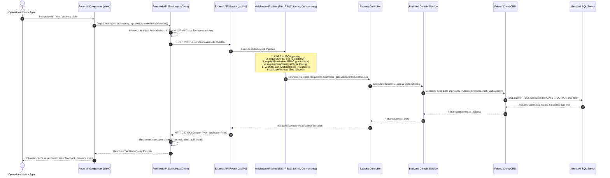

# Document 02: Complete System Architecture

## 1. High-Level Architectural Flow

The **NG ICD – DCC Logistics Suite** is structured as an enterprise-grade, multi-tiered, service-oriented web architecture. The flow of data and control strictly follows an end-to-end unidirectional pipeline with bidirectional state synchronization:



---

## 2. Layer-by-Layer Architectural Responsibilities

### Layer 1: Operational User & Client Devices
- **Desktop Workstations**: Dual-screen setups in Billing, Customer Service, and Operations Control Tower.
- **Tablet / Rugged Mobile Clients**: Utilized by Gate Lane clerks, Yard equipment operators, CFS tally clerks, and Reefer technicians.
- **External Web Users**: Clearing agents, shipping lines, and cargo owners accessing the Customer Self-Service Portal (`/portal`).

### Layer 2: Frontend Presentation Layer (`fe/src`)
- **Routing Engine (`fe/src/routes/routes.tsx`)**: Central route map wrapping views with `ProtectedRoute` for permission-based route shielding.
- **Feature Modules (`fe/src/features/*`)**: Domain-specific feature modules containing pages, view components, action drawers, slide-overs, and forms.
- **Design System (`fe/src/ds`)**: Standardized UI primitive library enforcing visual consistency and accessible UI components.
- **State Management & Data Fetching**:
  - **Server State**: Managed via **TanStack Query** (`useQuery`, `useMutation`) for automatic cache invalidation, polling, and optimistic updates.
  - **Session State**: Managed via `authService` in `fe/src/services/auth/authService.ts` utilizing `localStorage`, `sessionStorage`, and persistent HTTP cookies (`auth_token`).

### Layer 3: Frontend API Client & Interceptors (`fe/src/services/api/`)
- **`apiClient.ts` & `interceptors.ts`**: Centralized HTTP client built on native `fetch`.
- **Request Pipeline**:
  - Automatically attaches `Authorization: Bearer <token>`.
  - Automatically injects multi-tenancy context: `X-Site-Id: DAR1`.
  - Automatically injects RBAC context: `X-Role-Code: ICD_ADMIN`.
  - Automatically generates unique UUIDs for `Idempotency-Key` on mutating methods (`POST`, `PUT`, `PATCH`, `DELETE`).
- **Response Pipeline**:
  - Intercepts `401 Unauthorized` responses, clears tokens, and triggers re-routing to `/login`.
  - Intercepts `403 Forbidden` responses and triggers user notifications.
  - Parses RFC 7807 Problem Details and normalizes API error payloads.

### Layer 4: Backend Routing & Dispatcher (`be/src/routes/`, `be/src/v1/routes/`)
- Express routing aggregator (`be/src/app.ts`) mounting documentation (`/api/docs`), health diagnostics (`/api/health`), and versioned API routers (`/api/v1/`).
- **Dual-Mount Architecture**: Routes are mounted both at `/api/v1/*` and directly at `/api/*` to guarantee 100% backward compatibility between OpenAPI 3.1 contract specifications and legacy frontend client endpoints.

### Layer 5: Backend Middleware Pipeline (`be/src/middlewares/`)
1. **`cors`**: Whitelists configured origins (`http://localhost:5173`, `http://localhost:3000`) and exposes custom headers (`Idempotency-Key`, `If-Match`, `ETag`, `X-Site-Id`).
2. **`responseEnhancer`**: Utility middleware injecting standard helper methods (`res.success`, `res.created`, `res.error`) onto Express response objects.
3. **`requireSite` (`siteScope.ts`)**: Validates terminal site codes against registered facilities, setting `req.siteId`.
4. **`requirePermission` (`permission.ts`)**: Evaluates `X-Role-Code` against `ROLES` matrix and validates permission grant level (`DO`, `APPR`, `REQ`, `VIEW`).
5. **`requireIdempotency` (`concurrency.ts`)**: Caches transaction response payloads in memory using `Idempotency-Key` headers to prevent duplicate executions.
6. **`verifyIfMatch` (`concurrency.ts`)**: Compares client `If-Match` headers against database `log_inst` counters to enforce optimistic locking.
7. **`validateRequest` (`validate.ts`)**: Enforces strict Zod schema parsing on `req.params`, `req.query`, and `req.body`.
8. **`errorHandler` (`errorHandler.ts`)**: Global exception handler transforming runtime exceptions, Prisma database errors, and Zod validation errors into RFC 7807 Problem Details payloads.

### Layer 6: Backend Controllers (`be/src/v1/controllers/`)
- Unpacks HTTP requests, extracts route parameters, and handles HTTP response lifecycle.
- Checks whether database is connected via `isDbLive()`:
  - If live, executes Prisma ORM queries.
  - If offline/initializing, delegates to in-memory development repository (`fallbackStore.ts`).
- Maps database entities into frontend-facing DTOs.

### Layer 7: Backend Domain Services (`be/src/modules/*/`)
- Implements core business logic and cross-entity workflows (e.g., `CargoService`, `SetupService`).
- Enforces ICD terminal rules: cargo segregation, customs hold blocks, weighbridge tolerance comparisons, and five-pillar cargo release evaluations.

### Layer 8: Data Persistence & Prisma ORM (`be/src/configs/prisma.ts`, `be/prisma/schema.prisma`)
- **Prisma Client**: Object-Relational Mapping providing type-safe database queries.
- **Microsoft SQL Server (MSSQL)**: Enterprise relational database storing all 127 models with foreign key constraints, unique indexes, and audit columns (`createdate`, `updatedate`, `createdby`, `updatedby`, `log_inst`).
- **Dynamic In-Memory Fallback (`be/src/data/fallbackStore.ts`)**: Provides zero-downtime offline execution during local development and testing when SQL Server is unreachable.

---

## 3. Concurrency Model & Optimistic Locking

To prevent race conditions during simultaneous terminal operations (e.g., two operators assigning the same yard slot, or modifying a container while gate-in is running), the application implements **Optimistic Concurrency Control**:

1. Every transactional table contains a revision counter: `log_inst Int @default(1)`.
2. When the frontend reads a record, it receives `logInst` in the payload and saves it.
3. When submitting an update (`PUT` or `PATCH`), the frontend sends the HTTP header:
   ```http
   If-Match: "1"
   ```
4. The backend middleware executes:
   ```typescript
   export function verifyIfMatch(currentLogInst: number, req: Request, res: Response): boolean {
     const ifMatchHeader = req.headers['if-match'];
     if (!ifMatchHeader) return true;
     const expectedInst = parseInt(String(ifMatchHeader).replace(/"/g, ''), 10);
     if (!isNaN(expectedInst) && expectedInst !== currentLogInst) {
       res.status(412).json({
         type: 'https://api.icd.dcc/errors/concurrency-precondition-failed',
         title: 'Precondition Failed',
         status: 412,
         detail: `Record has been modified by another transaction. Expected logInst: ${expectedInst}, current: ${currentLogInst}.`
       });
       return false;
     }
     return true;
   }
   ```
5. On successful update, the database updates the record and increments `log_inst = log_inst + 1`.

---

## 4. Idempotency Architecture

For non-idempotent operations where network timeouts or duplicate button clicks could create duplicate financial transactions or duplicate gate-ins (e.g., `POST /payments`, `POST /gate/visits`, `POST /invoices`), the frontend automatically injects an `Idempotency-Key` header:

```typescript
// fe/src/services/api/interceptors.ts
if (['POST', 'PUT', 'PATCH', 'DELETE'].includes(method) && !config.headers['Idempotency-Key']) {
  config.headers['Idempotency-Key'] = crypto.randomUUID();
}
```

The backend `requireIdempotency` middleware caches successful responses keyed by this UUID:
- If a request arrives with an existing key, the backend returns the cached response directly with header `X-Cache-Lookup: HIT` without re-executing business logic.
- Prevents double-charging customers and duplicate gate passes.

