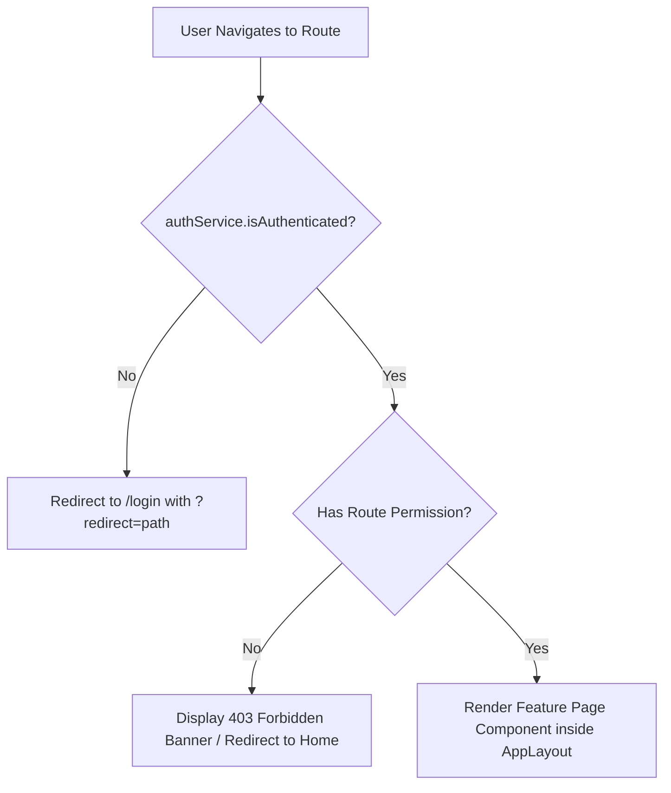

# Document 03: Frontend Workflow & Component Architecture

## 1. Frontend Architecture & Directory Map

The **NG ICD** frontend is a high-performance Single Page Application (SPA) built with React 18, TypeScript, and Vite. The codebase adheres strictly to feature-sliced domain organization:

```
fe/src/
├── api/                      # Type definitions & contract schemas (contract.d.ts, query.ts)
├── app/                      # Application shell, providers, session, and role constants
├── assets/                   # Static icons, logos, typography, and global stylesheets
├── components/               # Global cross-cutting presentation components (feedback, common)
├── config/                   # Runtime environment configuration
├── constants/                # Global lookup keys, storage keys, and status enums
├── contexts/                 # Global UI state contexts
├── ds/                       # DCC Design System (Button, Input, Field, Select, Table, Drawer, Modal, Banner)
├── features/                 # Modular domain features (screens, drawers, queries, mutations)
│   ├── auth/                 # Authentication, Login, Role switching
│   ├── billing/              # Charges, Invoices, Cashier, Refunds, Disbursements, Tariffs, Ledger
│   ├── container-management/ # Units, Consignments, Vessel Calls, Manifests, Holds, Releases, DG
│   ├── customer-management/  # Self-Service Portal, Service Requests, Parties & CRM
│   ├── customs/              # Customs declarations, physical examination queues
│   ├── dashboard/            # Home overview, personal action inbox
│   ├── gate-management/      # Gate Queue, Tablet Lane Check-in, Truck Visits, Weighbridge, Appointments
│   ├── master-data/          # Sites, Yard Designer, Gates, Unit Types, Masters, Users, Rules, Devices
│   ├── reports/              # Control Tower, KPIs, Operational Reports, Yard Forecasts, Audit Log
│   ├── transport/            # Approvals inbox, Exception cases & resolution workflows
│   └── yard-management/      # Interactive Yard Map, Move Orders, Inspections, Keys, CFS, Reefers, Repairs
├── hooks/                    # Reusable React utility hooks
├── layouts/                  # AppLayout, Sidebar, TopNavigation, FacilitySwitcher
├── routes/                   # Central route catalog (routes.tsx), ProtectedRoute, routeConfig
├── services/                 # API client, HTTP interceptors, Auth storage, Logger
├── shared/                   # Shared UI primitives, Table cells, Badges
├── styles/                   # Global CSS, Tailwind utilities, Theme definitions
└── utils/                    # Formatting, date helpers, cookie management, validation helpers
```

---

## 2. Route Registry & Access Protection

Routes are declared exclusively in `fe/src/routes/routes.tsx`. Route-level security is enforced via `fe/src/routes/ProtectedRoute.tsx`:



### Complete Route Map (`fe/src/routes/routes.tsx`):

| Path | Feature Component | Required Role / Permission | Description |
|---|---|---|---|
| `/login` | `LoginPage` | Public | Credentials & Two-Step Role/Site Selector |
| `/` | `DashboardPage` | Authenticated | Operational KPI tiles and quick-launch widgets |
| `/inbox` | `InboxPage` | Authenticated | User-specific notifications and pending approvals |
| `/gate` | `GateQueuePage` | `gate.visit.checkin` | Truck arrival queue and gate dispatch board |
| `/gate/lane` | `GateLanePage` | `gate.visit.checkin` | Tablet-optimized gate camera / OCR & check-in view |
| `/gate/visits/:truckVisitId` | `TruckVisitPage` | `gate.visit.checkin` | Detailed truck visit record, transactions, and gate pass |
| `/appointments` | `AppointmentsPage` | `appointment.manage` | Pre-booked gate slots and slot rule management |
| `/weighbridge` | `WeighbridgePage` | `weighbridge.ticket` | Inbound gross and outbound tare weighing scale tickets |
| `/units` | `ContainerList` | `consignment.view` | Master container grid with multi-filter search |
| `/units/:unitStayId` | `ContainerDetails` | `consignment.view` | Unit stay timeline, holds, locations, inspections |
| `/consignments` | `Consignments` | `consignment.view` | Bills of lading and consignment master records |
| `/vessel-calls` | `VesselCalls` | `consignment.view` | Mother vessel arrival schedules and discharge tracking |
| `/manifests` | `Manifests` | `manifest.import` | EDI / Excel manifest upload and cargo line ingestion |
| `/holds` | `Holds` | `consignment.view` | Regulatory, line, and terminal holds board |
| `/releases` | `Releases` | `consignment.view` | Cargo release orders, 5-pillar validation status |
| `/releases/:releaseOrderId`| `ReleaseDetail` | `consignment.view` | Release order QR code, validity, and unit assignment |
| `/dangerous-goods` | `DangerousGoods` | `dg.manage` | IMO class listings and yard segregation matrix |
| `/yard` | `YardMapPage` | `yard.map.view` | Visual 2D yard block canvas, bay/row/tier matrix |
| `/moves` | `MovesPage` | `yard.move.execute` | Move orders board (Open, Dispatched, In Progress, Done) |
| `/inspections` | `InspectionsPage` | `inspection.perform` | Container and vehicle survey records |
| `/inspections/:inspectionId`| `InspectionFormPage`| `inspection.perform` | Interactive damage mapping canvas and finding logger |
| `/keys` | `KeysPage` | `yard.key.custody` | Vehicle key cabinet grid and custody sign-in/out |
| `/cfs` | `CfsPage` | `cfs.job.manage` | CFS stripping, stuffing, and cross-docking jobs |
| `/reefers` | `ReefersPage` | `reefer.manage` | Active reefer plug sessions, temperature logs |
| `/repairs` | `RepairsPage` | `repair.estimate` | Maintenance & Repair estimates, work orders |
| `/customs` | `CustomsPage` | `consignment.view` | Customs declaration references and examination queue |
| `/approvals` | `ApprovalsPage` | Authenticated | Multi-level financial and operational approval requests |
| `/exceptions` | `ExceptionsPage` | Authenticated | Operational incident cases and resolution tickets |
| `/charges` | `ChargesPage` | `billing.invoice.view`| Accrued billing events, charge lines, and fee waivers |
| `/invoices` | `InvoicesPage` | `billing.invoice.view`| Issued, paid, and cancelled commercial tax invoices |
| `/invoices/new` | `InvoiceNewPage` | `billing.invoice.create`| Multi-unit invoice builder and proforma converter |
| `/cashier` | `CashierPage` | `payment.record` | Cash desk shift drawer, payment capture, receipts |
| `/tariffs` | `TariffsPage` | `billing.rates.view` | Rate cards, charge codes, rules, and slab pricing |
| `/control-tower` | `ControlTowerPage` | `dashboard.control_tower` | Executive live terminal throughput and bottleneck KPIs |
| `/portal` | `PortalPage` | `portal.access` | Customer Self-Service Portal for agents/importers |
| `/admin/*` | Master Data Pages | `admin.site.manage` | Sites, gates, users, rules, devices, and settings |

---

## 3. Top Navigation & Global Multi-Tenant Switching

The application shell (`fe/src/layouts/`) contains the persistent Header bar with:
1. **Facility / Site Switcher**:
   - Reads active site code from `authService.getActiveSite()` (defaults to `DAR1`).
   - Allows switching between `DAR1`, `DAR2`, and `KBH1`.
   - On change, updates local storage, calls backend `/session/switch-site`, and refetches all TanStack queries for the new terminal context.
2. **Role Switcher (Development & Multi-Role Staff)**:
   - Allows selecting active role (e.g., `ICD_ADMIN`, `GATE_CLERK`, `CASHIER`).
   - Automatically injects the selected role code into the `X-Role-Code` HTTP header on all subsequent API requests.
3. **Notification Bell**:
   - Queries `GET /notifications/inbox` for real-time task alerts and approval pings.
4. **User Profile Dropdown**:
   - Displays user avatar, current role, site permissions, and logout trigger (`authApi.logout()`).

---

## 4. Design System Component Library (`fe/src/ds`)

The frontend relies on custom-engineered, accessibility-compliant design primitives:

| Component | Code Path | Description & Role in Workflows |
|---|---|---|
| `Table` | `fe/src/ds/components/Table.tsx` | Virtualized, sortable, paginated data grid with sticky headers, column filters, and row selection. |
| `Drawer` | `fe/src/ds/components/Drawer.tsx` | Slide-over panel (Right) for operational actions without losing table context (e.g., Check-in Truck, Waive Charge, Assign Move). |
| `Modal` | `fe/src/ds/components/Modal.tsx` | Centered dialog for destructive actions, confirmations, and document printing (e.g., Print Gate Pass, Cash Receipt). |
| `Field` | `fe/src/ds/components/Field.tsx` | Form wrapper providing label, validation error feedback, tooltip, and required indicators. |
| `Input` | `fe/src/ds/components/Input.tsx` | Standardized text, number, date, and search inputs with icon prefix/suffix. |
| `Select` | `fe/src/ds/components/Select.tsx` | Accessible dropdown select for master data lookups (Parties, Unit Types, Gates, Lanes). |
| `Badge` | `fe/src/ds/components/Badge.tsx` | Status pill with semantic colour mapping (Green for `CLEARED`/`PAID`, Amber for `PENDING`/`HELD`, Red for `REJECTED`/`OVERDUE`). |
| `Banner` | `fe/src/ds/components/Banner.tsx` | High-visibility alert banners for RFC 7807 Problem Details and hold warnings. |

---

## 5. Form Handling, Validation, and Optimistic UI Mutations

1. **Client Validations**:
   - Forms use Zod schemas in `fe/src/features/*/schemas/` for instant field validation before network dispatch.
2. **TanStack Mutation Flow**:
   ```typescript
   export function useCheckinMutation() {
     const queryClient = useQueryClient();
     return useMutation({
       mutationFn: (truckVisitId: number) => gateApi.checkin(truckVisitId),
       onMutate: async (truckVisitId) => {
         // Snapshot previous cache state
         await queryClient.cancelQueries({ queryKey: ['gate-visits'] });
         const previousVisits = queryClient.getQueryData(['gate-visits']);
         // Optimistically update status to 'ADMITTED'
         queryClient.setQueryData(['gate-visits'], (old: any) => ({
           ...old,
           items: old.items.map((v: any) => v.truckVisitId === truckVisitId ? { ...v, status: 'ADMITTED' } : v)
         }));
         return { previousVisits };
       },
       onError: (err, _id, context) => {
         // Roll back to previous cache on error
         if (context?.previousVisits) {
           queryClient.setQueryData(['gate-visits'], context.previousVisits);
         }
       },
       onSettled: () => {
         // Invalidate and refetch fresh database records
         queryClient.invalidateQueries({ queryKey: ['gate-visits'] });
       }
     });
   }
   ```
3. **Drawer Closing & Toast Notification**:
   - When a mutation completes, the active drawer automatically closes, and a success toast announces completion with the generated reference number (e.g., `Gate Pass GP-26-00412 Issued`).

