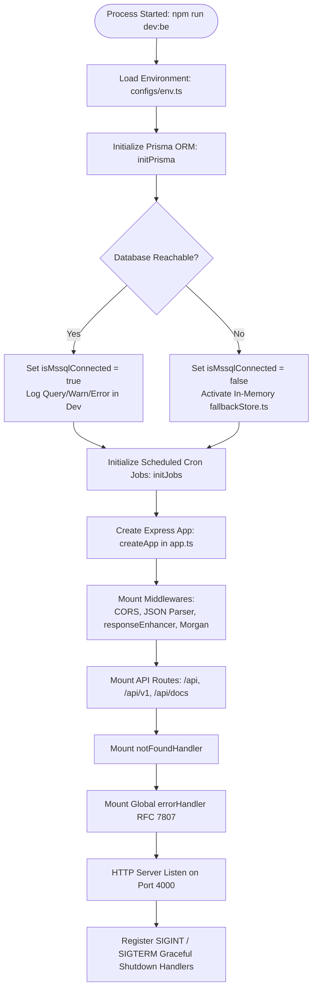

# Document 04: Backend Workflow & Service Architecture

## 1. Express Server Bootstrap & Lifecycle

The backend application is initialized via `be/src/server.ts` and structured through `be/src/app.ts`.



---

## 2. Route Aggregation & Hierarchy

The backend implements a multi-tiered routing structure designed for modularity and backwards compatibility:

```
be/src/routes/index.ts (apiRouter)
├── /docs                    -> swaggerRouter (OpenAPI 3.1 UI & JSON spec)
├── /health                  -> Health check endpoint ({ status: 'HEALTHY', ... })
├── /v1                      -> v1Router (be/src/v1/routes/index.ts)
└── / (direct fallback)      -> v1Router (Guarantees backward compatibility with legacy UI)
    ├── Structured Category Routes (Matching Frontend Views):
    │   ├── authRoutes       (be/src/v1/routes/auth/auth.routes.ts)
    │   ├── gateRoutes       (be/src/v1/routes/gate/gate.routes.ts)
    │   ├── yardRoutes       (be/src/v1/routes/yard/yard.routes.ts)
    │   ├── cargoRoutes      (be/src/v1/routes/cargo/cargo.routes.ts)
    │   ├── setupRoutes      (be/src/v1/routes/setup/setup.routes.ts)
    │   ├── billingRoutes    (be/src/v1/routes/billing/billing.routes.ts)
    │   ├── controlRoutes    (be/src/v1/routes/control/control.routes.ts)
    │   └── customersRoutes  (be/src/v1/routes/customers/customers.routes.ts)
    ├── Domain Specific Routers:
    │   ├── portalRouter     (be/src/v1/routes/portal.routes.ts)
    │   ├── unitsRouter      (be/src/v1/routes/units.routes.ts)
    │   ├── appointmentsRouter (be/src/v1/routes/appointments.routes.ts)
    │   ├── cfsRouter        (be/src/v1/routes/cfs.routes.ts)
    │   ├── reefersRouter    (be/src/v1/routes/reefers.routes.ts)
    │   ├── repairsRouter    (be/src/v1/routes/repairs.routes.ts)
    │   ├── devicesRouter    (be/src/v1/routes/devices.routes.ts)
    │   ├── partiesRouter    (be/src/v1/routes/parties.routes.ts)
    │   ├── searchRouter     (be/src/v1/routes/search.routes.ts)
    │   └── notificationsRouter (be/src/v1/routes/notifications.routes.ts)
    └── Legacy Module Routers:
        ├── sessionRouter    (be/src/modules/session/session.router.ts)
        ├── setupRouter      (be/src/modules/setup/setup.router.ts)
        ├── mastersRouter    (be/src/modules/masters/masters.router.ts)
        ├── accessRouter     (be/src/modules/access/access.router.ts)
        ├── cargoRouter      (be/src/modules/cargo/cargo.router.ts)
        ├── gateRouter       (be/src/modules/gate/gate.router.ts)
        ├── yardRouter       (be/src/modules/yard/yard.router.ts)
        ├── operationsRouter (be/src/modules/operations/operations.router.ts)
        ├── controlRouter    (be/src/modules/control/control.router.ts)
        ├── commercialRouter (be/src/modules/commercial/commercial.router.ts)
        ├── insightRouter    (be/src/modules/insight/insight.router.ts)
        └── depthRouter      (be/src/modules/depth/depth.router.ts)
```

---

## 3. Middleware Pipeline Execution Sequence

Every inbound request flows through a strict pipeline before hitting controller logic:

```mermaid
flowchart LR
    Req[Incoming HTTP Request] --> CORS[1. CORS Handler]
    CORS --> Parser[2. JSON / URLencoded Body Parser]
    Parser --> RespEnhance[3. responseEnhancer]
    RespEnhance --> Logger[4. Morgan Request Logger]
    Logger --> SiteScope[5. requireSite: Checks X-Site-Id]
    SiteScope --> Idemp[6. requireIdempotency: Checks Idempotency-Key]
    Idemp --> RBAC[7. requirePermission: Checks X-Role-Code & Grant]
    RBAC --> Validate[8. validateRequest: Zod Validation]
    Validate --> Concurrency[9. verifyIfMatch: Checks If-Match vs log_inst]
    Concurrency --> Controller[10. Controller Action Handler]
```



### Detailed Middleware Behavior:

1. **`responseEnhancer` (`be/src/utils/responseEnhancer.ts`)**:
   Attaches helper methods to `res`:
   - `res.success(data, total, meta)` -> wraps output in `{ success: true, data, total, meta }`.
   - `res.created(data)` -> sets status `201` and returns `{ success: true, data }`.
   - `res.error(message, status, code)` -> standard error envelope.

2. **`requireSite(isGlobal = false)` (`be/src/middlewares/siteScope.ts`)**:
   - If `isGlobal === true` (e.g., `/users`, `/companies`, `/me`), bypasses site check.
   - Otherwise, extracts site from header `X-Site-Id`, `X-Site`, or query parameter `siteId`.
   - Resolves valid site (`DAR1`, `DAR2`, `KBH1`). If invalid, returns `404 Site Not Found`.
   - Sets `req.siteId = validSite.siteId` for downstream queries.

3. **`requirePermission(permission, requiredGrant = 'VIEW')` (`be/src/middlewares/permission.ts`)**:
   - Extracts role code from header `X-Role-Code` or `req.user.roleCode` (defaults to `ALL_PERMISSIONS`).
   - Retrieves role definition from `ROLES` table.
   - Evaluates grant hierarchy: `DO` (4) > `APPR` (3) > `REQ` (2) > `VIEW` (1).
   - If the user's role grant is lower than required, returns `403 Permission Denied`.

4. **`requireIdempotency(isMandatory = false)` (`be/src/middlewares/concurrency.ts`)**:
   - Checks for `Idempotency-Key` header.
   - If present in the cache, returns the cached HTTP response with `X-Cache-Lookup: HIT`.
   - If new, wraps `res.json` to store successful HTTP responses (`200-299`) before returning.

5. **`verifyIfMatch(currentLogInst, req, res)` (`be/src/middlewares/concurrency.ts`)**:
   - Compares incoming `If-Match: "X"` against the record's current `log_inst`.
   - Returns `412 Precondition Failed` if they do not match.

6. **`validateRequest({ body, query, params })` (`be/src/middlewares/validate.ts`)**:
   - Validates request components using Zod schemas.
   - On error, formats field errors and calls `next(new ValidationError(invalidParams))`.

7. **Global Error Handler (`be/src/middlewares/errorHandler.ts`)**:
   - Intercepts all unhandled errors and maps them to **RFC 7807 Problem Details** (`application/problem+json`):
     - `AppError` -> HTTP status, code, details.
     - `ZodError` -> HTTP 422 with `invalidParams` array (`name`, `reason`, `path`).
     - `PrismaClientKnownRequestError`:
       - `P2002` (Unique constraint) -> HTTP 409 Conflict.
       - `P2025` (Record not found) -> HTTP 404 Not Found.
       - `P2003` (Foreign key violation) -> HTTP 400 Foreign Key Violation.
     - Other -> HTTP 500 Internal Server Error.

---

## 4. Prisma ORM & Database Access Architecture

The database connection is managed centrally in `be/src/configs/prisma.ts`:

1. **Connection Strategy**:
   - Evaluates `ENV.DATABASE_URL`.
   - If `DATABASE_URL` is empty or contains placeholder password (`YourStrong@Passw0rd`), bypasses live database connection and enables in-memory fallback.
   - If configured, executes `prisma.$connect()`.
2. **Model Aliasing**:
   Prisma enforces singular model names matching the database schema (`unit_stay`, `appointment`, `invoice`). To allow backward compatibility with code expecting pluralized repository names, `configs/prisma.ts` creates property aliases on the client instance:
   ```typescript
   p.unit_stays = p.unit_stay;
   p.appointments = p.appointment;
   p.invoices = p.invoice;
   p.invoice_lines = p.invoice_line;
   p.cargo_units = p.cargo_unit;
   p.truck_visits = p.truck_visit;
   p.yard_moves = p.yard_move;
   p.parties = p.m_party;
   ```
3. **Dual-Mode Controller Pattern**:
   All controllers verify database connectivity using `isDbLive()`:
   ```typescript
   if (isDbLive()) {
     const prisma = getPrisma();
     if (prisma) {
       const records = await prisma.truck_visit.findMany({ ... });
       return res.json(records);
     }
   }
   // Fallback to in-memory store for offline development
   return res.json(fallbackStore.visits);
   ```

---

## 5. Background Jobs & Scheduled Workers (`be/src/jobs/index.ts`)

The background job scheduler is initialized at server startup:
- **Dwell Time & Demurrage Accrual**: Daily calculation of storage days for units on site exceeding free days.
- **Reefer Monitoring Alerts**: Periodic check of active reefer sessions to identify unlogged temperature readings exceeding 2 hours.
- **Outbox Event Dispatcher**: Polling `outbox_event` table for integration messages awaiting external webhook/EDI dispatch.
- **Cashier Shift Auto-Reconciliation**: Flags unclosed shifts exceeding 24 hours.

