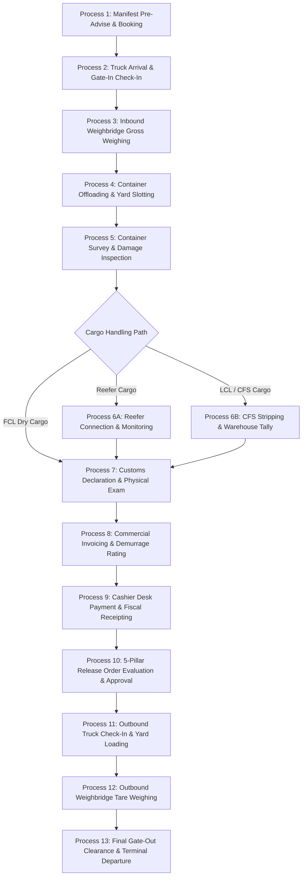

# Document 06: Complete ICD Business Process Documentation

This document maps the real-world, end-to-end chronological lifecycle of cargo through the **NG ICD – DCC Logistics Suite**, from pre-advise and arrival to final terminal exit.

---

## 🗺️ Chronological Operational Overview

---

## Process 1: Manifest Ingestion & Cargo Pre-Advise

### A. How the process starts
A shipping line transmits an electronic manifest (BAPLIE / EDIFACT or Excel/CSV) for an incoming vessel call discharging at the port.

### B. User performing the operation
`MANIFEST_CLERK` or `DOCUMENTATION_OFFICER`

### C. Frontend screen opened
`/manifests` (`fe/src/features/container-management/manifests/index.tsx`)

### D. Form or modal submitted
`ManifestUploadModal.tsx`: User selects the Vessel Call from dropdown, attaches manifest file (`.csv`, `.xlsx`), and clicks **"Ingest Manifest"**.

### E. API called
`POST /api/v1/manifests` (via `cargoApi.uploadManifest`)

### F. Backend route receiving request
`be/src/v1/routes/cargo/cargo.routes.ts`

### G. Controller executing
`cargoManifestsController.uploadManifest` / `CargoService.uploadManifest`

### H. Services and helper functions called
`CargoService.ingestManifestLines`, `parseManifestFile`

### I. Database tables queried
- `SELECT FROM vessel_call WHERE vessel_call_id = @id`
- `SELECT FROM m_party WHERE party_name = @shippingLine`

### J. Records inserted, updated or deleted
- **INSERT INTO** `manifest`: Header record (`vessel_call_id`, `status = 'PROCESSED'`).
- **INSERT INTO** `manifest_line`: Line records with container numbers, ISO codes, seal numbers, weights, and consignee names.
- **INSERT INTO** `cargo_unit`: Created if container does not exist.
- **INSERT INTO** `unit_stay`: Created with `flow = 'IMPORT'`, `physical_status = 'EXPECTED'`, `customs_status = 'NOT_LODGED'`, `billing_status = 'ACCRUING'`, `release_status = 'NONE'`.

### K. Foreign keys connecting records
- `manifest_line.manifest_id` -> `manifest.manifest_id`
- `unit_stay.cargo_unit_id` -> `cargo_unit.cargo_unit_id`
- `unit_stay.manifest_line_id` -> `manifest_line.manifest_line_id`

### L. Response returned
`HTTP 201 Created` with JSON: `{ manifestId: 104, importedLines: 42, newUnits: 42 }`.

### M. Frontend UI update
TanStack Query invalidates `['manifests']` and `['units']`. The modal closes and a toast displays: `Manifest imported successfully. 42 containers pre-advised.`

### N. Failure behavior
If duplicate container numbers appear in the manifest file, the transaction rolls back with `409 Conflict`, displaying line error numbers in a Banner.

### O. Next business process
**Process 2: Truck Arrival & Gate-In Check-In** (when container arrives by road/rail).

---

## Process 2: Truck Arrival & Gate-In Check-In

### A. How the process starts
A flatbed container truck carrying the import container arrives at the terminal Outer Gate.

### B. User performing the operation
`GATE_CLERK` on desktop or tablet (`/gate/lane`).

### C. Frontend screen opened
`/gate` (`fe/src/features/gate-management/pages/GateQueuePage.tsx`)

### D. Form or modal submitted
`CheckinDrawer.tsx` (or `CreateVisitDrawer.tsx` if unannounced): Plate Number `T 902 DMB`, Driver Name `Juma Ally`, License No, Transporter, Container No `MSKU 882014 9`, Seal No.

### E. API called
`POST /api/v1/truck-visits` (followed by `POST /api/v1/truck-visits/:id:checkin`)

### F. Backend route receiving request
`be/src/v1/routes/gate/gate.routes.ts`

### G. Controller executing
`gateVisitsController.createVisit` and `gateVisitsController.checkin`

### H. Services and helper functions called
`normalizeVisitStatus`, `getPrisma`

### I. Database tables queried
- `SELECT FROM m_truck WHERE plate_no = @plateNo` (creates if missing)
- `SELECT FROM m_driver WHERE driver_name = @driverName` (creates if missing)
- `SELECT FROM cargo_unit WHERE unit_no = @unitNo`
- `SELECT FROM unit_stay WHERE cargo_unit_id = @id AND departed_at IS NULL`

### J. Records inserted, updated or deleted
- **INSERT INTO** `truck_visit`: (`status = 'AT_OUTER_GATE'`, `current_seq_no = 1`, `arrived_at = NOW()`).
- **INSERT INTO** `visit_unit_txn`: (`truck_visit_id`, `unit_stay_id`, `direction = 'DROP'`, `status = 'PLANNED'`).
- **INSERT INTO** `visit_checkpoint_event`: (`checkpoint_code = 'OUTER_IN'`, `result = 'PASS'`).
- **UPDATE** `truck_visit`: (`status = 'ADMITTED'`, `current_seq_no = 2`, `admitted_at = NOW()`).
- **UPDATE** `unit_stay`: (`physical_status = 'IN_YARD'`, `gated_in_at = NOW()`).

### K. Foreign keys connecting records
- `visit_unit_txn.truck_visit_id` -> `truck_visit.truck_visit_id`
- `visit_unit_txn.unit_stay_id` -> `unit_stay.unit_stay_id`

### L. Response returned
`HTTP 201 Created`: `{ truckVisitId: 412, visitNo: "VIS-26-88120", status: "ADMITTED", nextCheckpointCode: "INNER_IN" }`.

### M. Frontend UI update
The truck record moves dynamically from the "Outer Queue" tab to the "Admitted Trucks in Yard" board.

### N. Failure behavior
If the truck already has an open visit in progress, returns `409 Conflict: Truck already inside terminal`.

### O. Next business process
**Process 3: Inbound Weighbridge Gross Weighing**.

---

## Process 3: Inbound Weighbridge Gross Weighing

### A. How the process starts
Truck drives onto Inbound Weighbridge Scale 01 before proceeding into yard stacking areas.

### B. User performing the operation
`WEIGHBRIDGE_OP`

### C. Frontend screen opened
`/weighbridge` (`fe/src/features/gate-management/pages/WeighbridgePage.tsx`)

### D. Form or modal submitted
`CaptureWeightModal.tsx`: Selects Truck Visit `VIS-26-88120`, confirms scale reading (`38,500 kg`), and clicks **"Generate Weight Ticket"**.

### E. API called
`POST /api/v1/weighbridge/tickets`

### F. Backend route receiving request
`be/src/v1/routes/gate/gate.routes.ts`

### G. Controller executing
`gateWeighbridgeController.createTicket`

### H. Services and helper functions called
Tolerance calculation: compares `gross_kg - tare_kg` against manifest `declared_kg`.

### I. Database tables queried
- `SELECT FROM truck_visit WHERE truck_visit_id = @id`
- `SELECT FROM unit_stay WHERE unit_stay_id = @id`

### J. Records inserted, updated or deleted
- **INSERT INTO** `weighing`: (`ticket_no = 'WT-DAR1-26-0819'`, `weigh_kind = 'IN'`, `gross_kg = 38500.0`, `within_tolerance = true`, `weighed_at = NOW()`).

### K. Foreign keys connecting records
- `weighing.truck_visit_id` -> `truck_visit.truck_visit_id`
- `weighing.unit_stay_id` -> `unit_stay.unit_stay_id`

### L. Response returned
`HTTP 201 Created`: `{ weighingId: 819, ticketNo: "WT-DAR1-26-0819", withinTolerance: true, status: "OK" }`.

### M. Frontend UI update
A green checkmark appears on the Weighbridge ticket table; weight values attach to the truck visit card.

### N. Failure behavior
If weight exceeds legal axle tolerance, `within_tolerance = false` and ticket status becomes `OVERRIDE_PENDING`. Triggers approval request.

### O. Next business process
**Process 4: Container Offloading & Yard Slotting**.

---

## Process 4: Container Offloading & Yard Slotting

### A. How the process starts
The truck halts at Bay `A-04`. The yard controller creates or dispatches an offload work order to a reach stacker.

### B. User performing the operation
`YARD_PLANNER` (dispatcher) and `EQUIPMENT_OPERATOR` (driver in cabin).

### C. Frontend screen opened
`/yard` (Yard Map) or `/moves` (`fe/src/features/yard-management/pages/MovesPage.tsx`).

### D. Form or modal submitted
`CreateMoveDrawer.tsx`: Container `MSKU 882014 9`, Move Kind `OFFLOAD`, Destination Slot `A-04-02-1`, Equipment `RS-02` (Reach Stacker 02). Operator clicks **"Dispatch Move"**.

### E. API called
`POST /api/v1/moves` (followed by `POST /api/v1/moves/:id/complete`)

### F. Backend route receiving request
`be/src/v1/routes/yard/yard.routes.ts`

### G. Controller executing
`yardMovesController.createMoveOrder` and `yardMovesController.completeMove`

### H. Services and helper functions called
`parseBigIntId`, `normalizeMoveKind`, `getRequestContext`

### I. Database tables queried
- `SELECT FROM unit_stay WHERE unit_stay_id = @id`
- `SELECT FROM m_yard_location WHERE full_code = 'A-04-02-1'`
- `SELECT FROM m_equipment WHERE equipment_id = @id`

### J. Records inserted, updated or deleted
- **INSERT INTO** `move_order`: (`status = 'OPEN'`, `move_kind = 'OFFLOAD'`, `to_location_id`).
- **UPDATE** `move_order`: (`status = 'DONE'`, `completed_at = NOW()`).
- **UPDATE** `unit_stay`: (`current_location_id = @toLocationId`, `physical_status = 'IN_YARD'`).
- **INSERT INTO** `yard_move`: (Immutable historical transaction recording `occurred_at`, `equipment_id`, `operator_sub`).
- **INSERT INTO** `billable_event`: (`charge_code = 'LOLO'`, `quantity = 1`, `dedupe_key = 'LOLO-STAY-42'`).

### K. Foreign keys connecting records
- `move_order.unit_stay_id` -> `unit_stay.unit_stay_id`
- `yard_move.move_order_id` -> `move_order.move_order_id`
- `unit_stay.current_location_id` -> `m_yard_location.yard_location_id`

### L. Response returned
`HTTP 200 OK`: `{ success: true, moveOrderId: 914, status: "DONE", completedAt: "ISO_DATE" }`.

### M. Frontend UI update
On `/yard`, the 2D block canvas updates slot `A-04-02-1` from white (available) to blue (occupied) displaying the container number.

### N. Failure behavior
If the target slot is already occupied, the reach stacker terminal warns the operator and prompts for an alternate slot re-allocation.

### O. Next business process
**Process 5: Container Survey & Damage Inspection**.

---

## Process 5: Container Survey & Damage Inspection

### A. How the process starts
Depot surveyor approaches the offloaded container in the stack or inspection area to record condition.

### B. User performing the operation
`SURVEYOR`

### C. Frontend screen opened
`/inspections` -> `/inspections/:inspectionId` (`InspectionFormPage.tsx`)

### D. Form or modal submitted
`InspectionFormView.tsx`: Surveyor clicks on the Left Wall of the 3D/2D wireframe diagram, selects Damage Code `DT` (Dent), severity `MINOR`, depth `4 cm`, and clicks **"Complete Inspection"**.

### E. API called
`POST /api/v1/yard/inspections/:id/findings` followed by `POST /api/v1/yard/inspections/:id:complete`

### F. Backend route receiving request
`be/src/v1/routes/yard/yard.routes.ts`

### G. Controller executing
`yardInspectionsController.recordFinding` and `yardInspectionsController.completeInspection`

### H. Database tables queried & updated
- **INSERT INTO** `inspection_finding`: (`damage_code_id`, `area = 'LEFT_WALL'`, `severity = 'MINOR'`, `size_cm = 4`).
- **UPDATE** `inspection`: (`status = 'COMPLETED'`, `overall_condition = 'SOUND'`, `completed_at = NOW()`).
- **UPDATE** `unit_stay`: (`condition_status = 'SOUND'`).

### I. Response returned
`HTTP 200 OK`: `{ success: true, inspectionId: 301, overallCondition: "SOUND" }`.

### J. Next business process
- If Reefer -> **Process 6A: Reefer Connection**.
- If LCL / CFS -> **Process 6B: CFS Stripping**.
- If FCL Dry -> **Process 7: Customs Declaration & Examination**.

---

## Process 7: Customs Declaration, Examination & Clearances

### A. How the process starts
Clearing agent lodges a customs declaration (TANSAD) with the Tanzania Revenue Authority (TRA). Customs schedules a 100% physical examination.

### B. User performing the operation
`CUSTOMS_OFFICER`

### C. Frontend screen opened
`/customs` (`fe/src/features/customs/pages/CustomsPage.tsx`)

### D. Form or modal submitted
`CompleteExamDrawer.tsx`: User confirms old seal `ML-TZ-10492` removed, verifies cargo matches declaration, inputs replacement customs lead seal `TRA-SEAL-88421`, and selects result `CLEARED`.

### E. API called
`POST /api/v1/exams/:examId:complete`

### F. Backend route receiving request
`be/src/v1/routes/cargo/cargo.routes.ts` / `be/src/modules/control/control.router.ts`

### G. Controller executing
`CargoService.completeCustomsExam`

### H. Database tables queried & updated
- **UPDATE** `exam`: (`status = 'COMPLETED'`, `result = 'CLEARED'`, `seal_removed`, `seal_applied`, `completed_at = NOW()`).
- **UPDATE** `unit_stay`: (`customs_status = 'CLEARED'`, `seal_no = 'TRA-SEAL-88421'`).

### I. Response returned
`HTTP 200 OK`: `{ success: true, examId: 55, customsStatus: "CLEARED" }`.

### J. Next business process
**Process 8: Commercial Invoicing & Demurrage Rating**.

---

## Process 8: Commercial Invoicing & Demurrage Rating

### A. How the process starts
The clearing agent requests an invoice to pay depot storage, lift fees, customs exam fees, and gate charges.

### B. User performing the operation
`BILLING_SPECIALIST`

### C. Frontend screen opened
`/invoices/new` (`fe/src/features/billing/pages/InvoiceNewPage.tsx`)

### D. Form or modal submitted
`InvoiceNewView.tsx`: User enters Consignment or Container number, system aggregates all unrated `billable_event` records, applies tariff rules (7 free days, day 8-14 @ $20/day, lift-on $50, exam fee $40, VAT 18%), and clicks **"Generate Commercial Invoice"**.

### E. API called
`POST /api/v1/invoices`

### F. Backend route receiving request
`be/src/v1/routes/billing/billing.routes.ts`

### G. Controller executing
`billingInvoicesController.createInvoice`

### H. Database tables queried & updated
- **INSERT INTO** `invoice`: (`invoice_no = 'INV-DAR1-26-00412'`, `party_id = 14`, `subtotal = 210.00`, `tax_total = 37.80`, `total = 247.80`, `status = 'ISSUED'`).
- **INSERT INTO** `invoice_line`: Linked lines for Storage, LOLO, Exam.
- **UPDATE** `charge`: (`status = 'INVOICED'`).
- **UPDATE** `unit_stay`: (`billing_status = 'INVOICED'`).

### I. Response returned
`HTTP 201 Created` with invoice payload.

### J. Next business process
**Process 9: Cashier Desk Payment & Fiscal Receipting**.

---

## Process 9: Cashier Desk Payment & Fiscal Receipting

### A. How the process starts
Clearing agent arrives at terminal cashier counter or submits bank transfer slip.

### B. User performing the operation
`CASHIER`

### C. Frontend screen opened
`/cashier` (`fe/src/features/billing/pages/CashierPage.tsx`)

### D. Form or modal submitted
`TakePaymentForm.tsx`: Searches invoice `INV-DAR1-26-00412`, selects Payment Channel `BANK_TRANSFER`, enters bank reference `STANBIC-REF-99120`, captures amount `$247.80`, and clicks **"Post Payment"**.

### E. API called
`POST /api/v1/payments`

### F. Backend route receiving request
`be/src/v1/routes/billing/billing.routes.ts`

### G. Controller executing
`billingCashierController.recordPayment`

### H. Database tables queried & updated
- **INSERT INTO** `payment`: (`receipt_no = 'REC-26-00812'`, `amount = 247.80`, `currency = 'USD'`, `status = 'COMPLETED'`).
- **INSERT INTO** `payment_allocation`: (`payment_id`, `invoice_id`, `allocated_amount = 247.80`).
- **UPDATE** `invoice`: (`paid_amount = 247.80`, `status = 'PAID'`).
- **UPDATE** `unit_stay`: (`billing_status = 'PAID'`).

### I. Response returned
`HTTP 201 Created`: `{ paymentId: 812, receiptNo: "REC-26-00812", status: "COMPLETED" }`.

### J. Next business process
**Process 10: 5-Pillar Release Order Evaluation & Approval**.

---

## Process 10: 5-Pillar Release Order Evaluation & Approval

### A. How the process starts
Clearing agent or cargo owner applies for a cargo release permit to remove the container from the ICD.

### B. User performing the operation
`RELEASE_OFFICER` or `TERMINAL_MANAGER`

### C. Frontend screen opened
`/releases` -> `/releases/:releaseOrderId` (`ReleaseDetail.tsx`)

### D. Form or modal submitted
`EvaluatePillarsDrawer.tsx`: System automatically queries:
1. Customs Status: `CLEARED` (PASS)
2. Commercial Line DO: Valid (PASS)
3. Billing Status: `PAID` (PASS)
4. Active Holds: `0` (PASS)
5. Nominated Transporter: `Global Haulage Ltd` (PASS)
Officer clicks **"Approve & Issue Gate Pass QR"**.

### E. API called
`POST /api/v1/release-orders/:id:approve`

### F. Backend route receiving request
`be/src/modules/control/control.router.ts`

### G. Controller executing
`CargoService.approveReleaseOrder`

### H. Database tables queried & updated
- **UPDATE** `release_order`: (`status = 'APPROVED'`, `approved_at = NOW()`, `qr_token = 'QR-REL-DAR1-26-0991'`, `valid_to = NOW() + 24 HOURS`).
- **UPDATE** `unit_stay`: (`release_status = 'APPROVED'`).
- **INSERT INTO** `release_check`: Checkpoint snapshot JSON audit.

### I. Response returned
`HTTP 200 OK`: `{ success: true, status: "APPROVED", qrToken: "QR-REL-DAR1-26-0991" }`.

### J. Next business process
**Process 11 & 12: Outbound Truck Loading & Tare Weighing**.

---

## Process 13: Final Gate-Out Clearance & Terminal Departure

### A. How the process starts
Truck loaded with container approaches the Outer Gate Out lane to leave the terminal.

### B. User performing the operation
`GATE_CLERK`

### C. Frontend screen opened
`/gate/lane` or `/gate/visits/:truckVisitId`

### D. Form or modal submitted
Gate Clerk scans Release QR code or clicks **"Validate & Gate Out"**.

### E. API called
`POST /api/v1/truck-visits/:id:checkout`

### F. Backend route receiving request
`be/src/v1/routes/gate/gate.routes.ts`

### G. Controller executing
`gateVisitsController.checkout`

### H. Database tables queried & updated
- **UPDATE** `truck_visit`: (`status = 'EXITED'`, `exited_at = NOW()`, `checked_out_at = NOW()`, `current_seq_no = 4`).
- **UPDATE** `unit_stay`: (`physical_status = 'DEPARTED'`, `departed_at = NOW()`, `release_status = 'COMPLETED'`).
- **INSERT INTO** `visit_checkpoint_event`: (`checkpoint_code = 'OUTER_OUT'`, `result = 'PASS'`).

### I. Response returned
`HTTP 200 OK`: `{ success: true, truckVisitId: 412, status: "EXITED", exitedAt: "ISO_DATE" }`.

### J. Next business process
Terminal lifecycle for this unit stay is **COMPLETE**. Container is now in international transit or returning as an empty repositioning unit.

