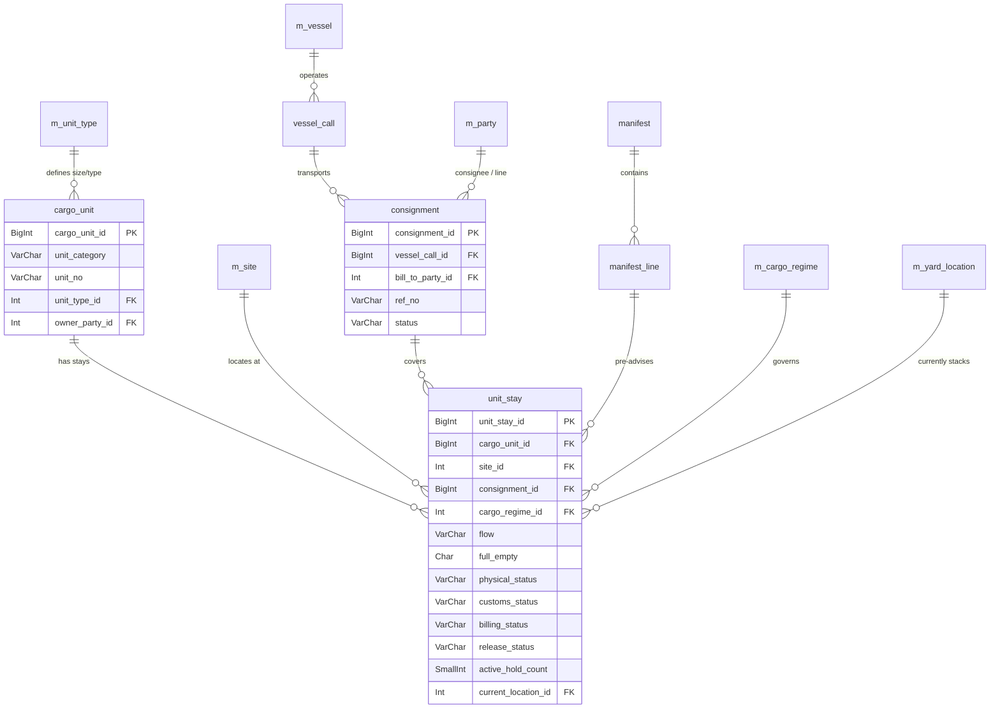
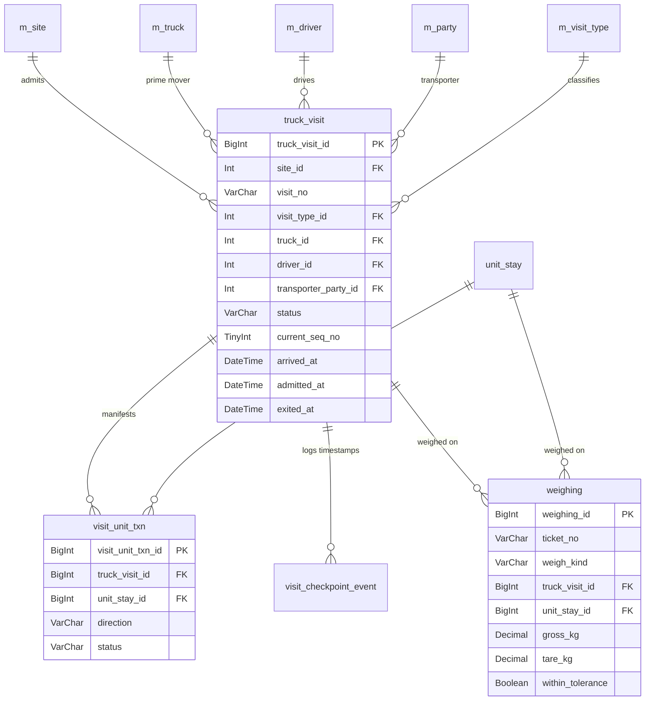
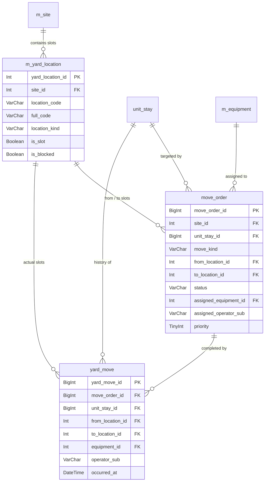
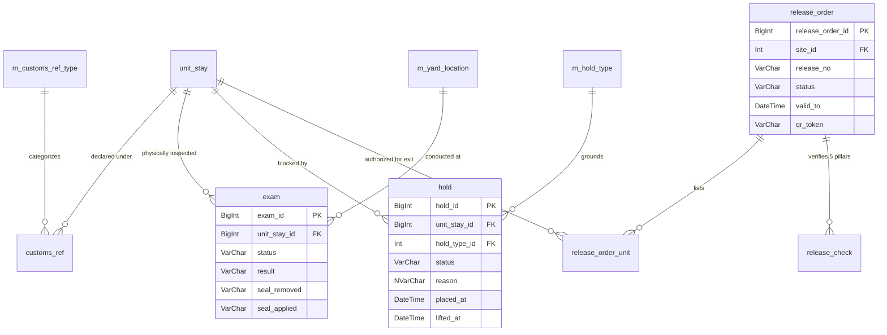
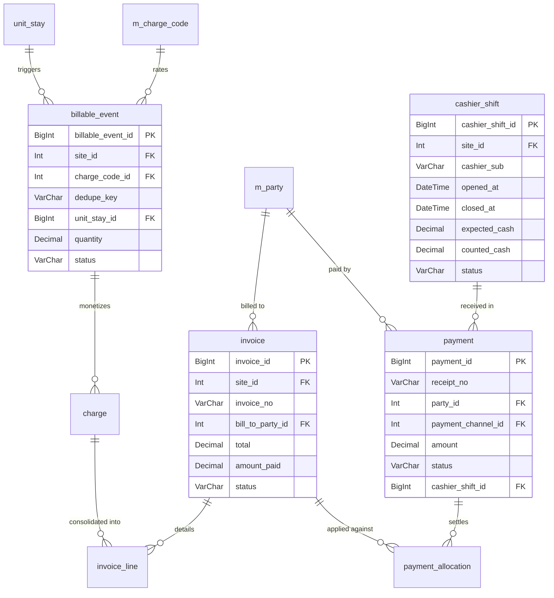

# Document 09: Database Relationship ERDs

This document provides comprehensive Mermaid Entity-Relationship Diagrams (ERDs) illustrating the primary keys, foreign keys, cardinalities, and relational dependencies across the **NG ICD – DCC Logistics Suite**.

---

## 1. Core Operational & Cargo ERD

---

## 2. Gate & Transport Movements ERD

---

## 3. Yard Management & Equipment Execution ERD

---

## 4. Customs, Holds & Release Pillars ERD

---

## 5. Commercial, Invoicing & Cashier Desk ERD

