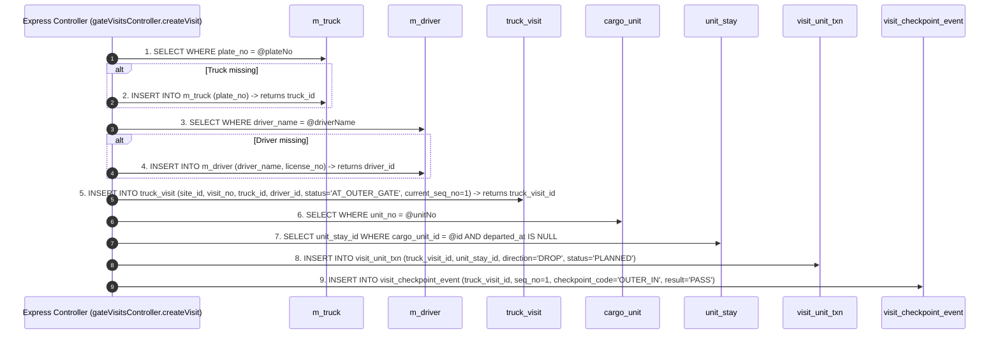
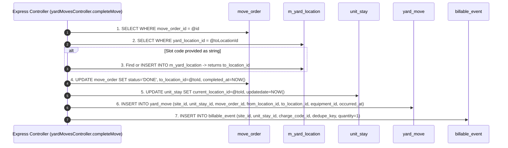
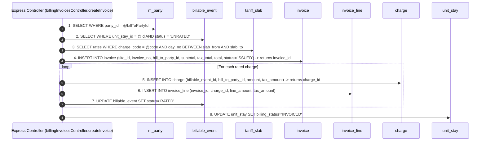
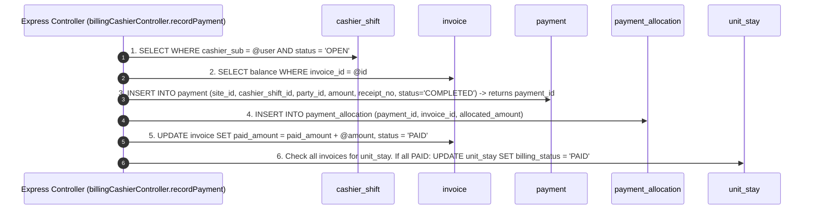
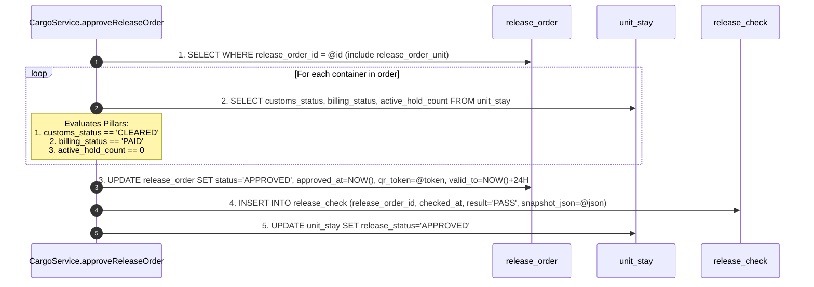

# Document 10: Table Interaction Workflow & Mutation Mechanics

This document provides a deep, query-by-query analysis of how the backend reads, inserts, and updates database tables during mission-critical business transactions.

---

## Workflow 1: Truck Gate-In & Container Arrival

### Table Mutation Sequence:
1. **`m_truck` (Read/Insert)**: Queries truck by license plate string. Inserts a new record if not registered in fleet master. Retrieves `truck_id`.
2. **`m_driver` (Read/Insert)**: Queries driver by name and license number. Inserts if new. Retrieves `driver_id`.
3. **`truck_visit` (Insert)**: Inserts visit header linking `site_id`, `truck_id`, `driver_id`, and `transporter_party_id`. Sets `status = 'AT_OUTER_GATE'`, `current_seq_no = 1`, and `arrived_at = SYSUTCDATETIME()`.
4. **`cargo_unit` & `unit_stay` (Read)**: Resolves container number string to active `unit_stay_id`.
5. **`visit_unit_txn` (Insert)**: Establishes container-to-truck association:
   - Foreign Keys: `truck_visit_id` (from Step 3), `unit_stay_id` (from Step 4).
6. **`visit_checkpoint_event` (Insert)**: Appends immutable gate audit milestone.

---

## Workflow 2: Yard Move Order Execution & Placement

### Table Mutation Sequence:
1. **`move_order` (Read)**: Fetches existing work order by `move_order_id`. Verifies status is `OPEN` or `ASSIGNED`.
2. **`m_yard_location` (Read/Insert)**: Resolves destination slot. If physical coordinates (`A-04-02-1`) do not exist, creates slot record on-the-fly. Retrieves `to_location_id`.
3. **`move_order` (Update)**: Sets `status = 'DONE'`, `completed_at = NOW()`, and increments `log_inst = log_inst + 1`.
4. **`unit_stay` (Update)**: Mutates the container's active physical position:
   - `UPDATE unit_stay SET current_location_id = @to_location_id WHERE unit_stay_id = @existing.unit_stay_id`.
5. **`yard_move` (Insert)**: Writes an immutable audit row linking:
   - `unit_stay_id`, `move_order_id`, `from_location_id`, `to_location_id`, `equipment_id`, and `occurred_at`.
6. **`billable_event` (Insert)**: If move kind was `OFFLOAD` or `LOAD`, registers a Lift-on / Lift-off (LOLO) billable trigger using deduplication key: `LOLO-${unitStayId}-${moveOrderId}`.

---

## Workflow 3: Commercial Invoicing & Demurrage Rating

### Table Mutation Sequence:
1. **`billable_event` (Read)**: Gathers unbilled events (LOLO, Storage Days, Reefer Electricity, Customs Exam Fee).
2. **`tariff` & `tariff_slab` (Read)**: Evaluates tier pricing (e.g., Days 1–7 free; Days 8–14 @ $20/day; Days 15+ @ $40/day).
3. **`invoice` (Insert)**: Creates invoice header with calculated `subtotal`, `tax_total` (18% VAT), and `total`. Sets `status = 'ISSUED'`.
4. **`charge` & `invoice_line` (Insert)**: Creates line item rows pointing to `invoice.invoice_id` and `charge.charge_id`.
5. **`unit_stay` (Update)**: Advances `billing_status` from `ACCRUING` to `INVOICED`.

---

## Workflow 4: Cashier Payment & Automated Settlement

### Table Mutation Sequence:
1. **`cashier_shift` (Read)**: Confirms the acting cashier currently has an open cash desk session.
2. **`payment` (Insert)**: Inserts payment record linking `cashier_shift_id`, `party_id`, `payment_channel_id`, `receipt_no`, and monetary amount.
3. **`payment_allocation` (Insert)**: Creates cross-reference record binding `payment_id` to `invoice_id`.
4. **`invoice` (Update)**: Increments `paid_amount`. If `paid_amount >= total`, sets `status = 'PAID'`.
5. **`unit_stay` (Update)**: If all invoices associated with the stay are settled, updates `billing_status = 'PAID'`.

---

## Workflow 5: Five-Pillar Cargo Release Clearance

### Table Mutation Sequence:
1. **`release_order` (Read)**: Loads clearance permit and linked containers via `release_order_unit`.
2. **`unit_stay` (Read & Validate)**:
   - Pillar 1: Asserts `customs_status === 'CLEARED'`.
   - Pillar 2: Asserts `billing_status === 'PAID'`.
   - Pillar 3: Asserts `active_hold_count === 0`.
3. **`release_order` (Update)**: Sets `status = 'APPROVED'`, stamps `approved_at`, creates `qr_token`, and establishes a 24-hour expiration window (`valid_to`).
4. **`release_check` (Insert)**: Saves serialized JSON snapshot of all 5 pillar statuses.
5. **`unit_stay` (Update)**: Advances container `release_status = 'APPROVED'`, authorizing security guards and gate lane tablets to permit physical exit.

