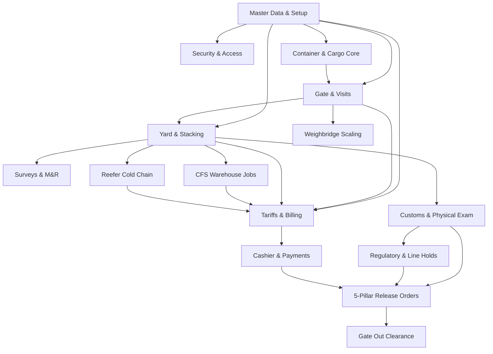

# Document 11: Module Dependency Workflows & Coupling Network

## 1. Inter-Module Dependency Network

The **NG ICD – DCC Logistics Suite** operates as a tightly integrated domain graph. Individual modules maintain specialized responsibilities while synchronizing state through core shared entities:

---

## 2. Core Shared Entities & Connecting Foreign Keys

The application achieves cross-module orchestration using 4 primary foreign key anchors:

| Shared Key | Originating Entity | Consuming Modules | Functional Role & Business Significance |
|---|---|---|---|
| **`unit_stay_id`** | `unit_stay` (Cargo Core) | Gate, Yard, Customs, Holds, CFS, Reefers, Inspections, Billing, Release | The universal container stay reference. Connects the container's physical movement in the yard, customs clearance status, commercial billing balance, and gate release permit. |
| **`truck_visit_id`** | `truck_visit` (Gate Core) | Gate Lanes, Weighbridge, Move Orders, Inspections, Release, Exception Cases | Tracks the external transport vehicle from outer arrival, scale weighing, yard loading/offloading, and gate departure. |
| **`invoice_id`** | `invoice` (Commercial Core) | Invoices, Cashier Payments, General Ledger, Release Orders | Connects billed terminal charges to cash desk payments, fiscal receipts, and 5-pillar financial clearance. |
| **`site_id`** | `m_site` (Master Data) | All Modules | Multi-tenancy tenant context isolating Dar es Salaam (`DAR1`, `DAR2`) and Kibaha (`KBH1`). |

---

## 3. Module Dependency Matrix

| Module | Classification | Upstream Prerequisite Modules | Downstream Dependent Modules | Key Shared Attributes |
|---|---|---|---|---|
| **Master Data (`setup`)** | Foundation | None | All Modules | `site_id`, `unit_type_id`, `party_id` |
| **Access & Auth (`access`)** | Foundation | Master Data | All Modules | `user_id`, `role_code`, `grants` |
| **Consignments & Cargo (`cargo`)** | Core Domain | Master Data | Gate, Yard, Customs, Billing, Release | `unit_stay_id`, `consignment_id`, `regime_code` |
| **Gate & Visits (`gate`)** | Core Operational | Cargo, Master Data | Weighbridge, Yard Moves, Release Out | `truck_visit_id`, `plate_no`, `current_seq_no` |
| **Weighbridge (`weighbridge`)**| Operational | Gate Visits, Cargo Stays | Approvals (if overweight), Gate Out | `weighing_id`, `gross_kg`, `tare_kg`, `variance_pct`|
| **Yard Management (`yard`)** | Core Operational | Gate Visits, Cargo Stays | Inspections, CFS, Reefers, Billing | `move_order_id`, `yard_location_id`, `current_location_id` |
| **Inspections / M&R (`inspections`)**| Operational | Yard Stacking, Gate Visits | Holds (if damaged), Repairs, Billing | `inspection_id`, `overall_condition`, `repair_estimate_id` |
| **Customs & Exams (`customs`)**| Regulatory | Cargo Stays, Yard Slots | Holds (if discrepancy), Release Orders | `customs_ref_id`, `exam_id`, `customs_status` |
| **Holds Management (`holds`)** | Governance | Customs, Line, Cargo | Release Orders, Gate Out | `hold_id`, `active_hold_count`, `hold_type_id` |
| **CFS Warehouse (`cfs`)** | Depth Operational| Cargo Stays, Yard Moves | Billing, Delivery Lots | `handling_job_id`, `lot_balance_id`, `packages_unloaded`|
| **Reefers (`reefers`)** | Depth Operational| Cargo Stays, Yard Slots | Billing, Alerts | `reefer_session_id`, `set_temp_c`, `readings` |
| **Vehicle Keys (`keys`)** | Depth Operational| Cargo Stays (Vehicles) | Release & Delivery | `key_custody_id`, `peg_ref`, `key_status` |
| **Billing & Invoices (`billing`)**| Commercial | All Operational Modules | Cashier Desk, Release Orders | `billable_event_id`, `invoice_id`, `billing_status` |
| **Cashier & Payments (`cashier`)**| Financial | Billing Invoices | Release Orders, Ledger | `payment_id`, `receipt_no`, `paid_amount` |
| **Release Orders (`release`)** | Clearance Gate | Customs, Holds, Billing, Cashier | Gate Out Check-Out | `release_order_id`, `qr_token`, `release_status` |
| **Approvals / Exceptions (`control`)**| Governance | Any Module Overrides | Target Module State Unlocking | `approval_request_id`, `exception_case_id` |

---

## 4. Coupling Boundaries & Isolation Analysis

### Highly Coupled Subsystems:
- **Cargo Core (`unit_stay`) + Gate Visits (`truck_visit`) + Yard Moves (`move_order`)**:
  These three form the operational triad. A gate-in creates a `truck_visit`, which triggers an `OFFLOAD` `move_order`, which changes the `unit_stay` physical location.
- **Billing (`invoice`) + Cashier (`payment`) + Release (`release_order`)**:
  These form the financial release triad. An invoice must be paid at the cashier desk to update `unit_stay.billing_status = 'PAID'`, which is an absolute prerequisite to generate an approved `release_order`.

### Loosely Coupled / Independent Subsystems:
- **Vehicle Key Custody (`key_custody`)**: Only activates when `unit_category === 'VEHICLE'`. Completely decoupled from container operations.
- **Reefer Monitoring (`reefer_session`)**: Operates independently in the background; only couples with billing via daily electricity charge events.
- **AIVA AI Assistant (`aiva_*`)**: Operates as a sidecar intelligence layer. Does not enforce direct foreign key constraints on operational tables; stores draft actions in JSON format until confirmed by the user.

