# Document 12: Status Lifecycles & State Machine Specifications

This document catalogs all 18 status fields across the **NG ICD** system, detailing their valid values, state machines, transition conditions, authorized roles, and database side effects.

---

## 1. Primary Operational State Machines

### 1.1 Truck Visit Status (`truck_visit.status`)

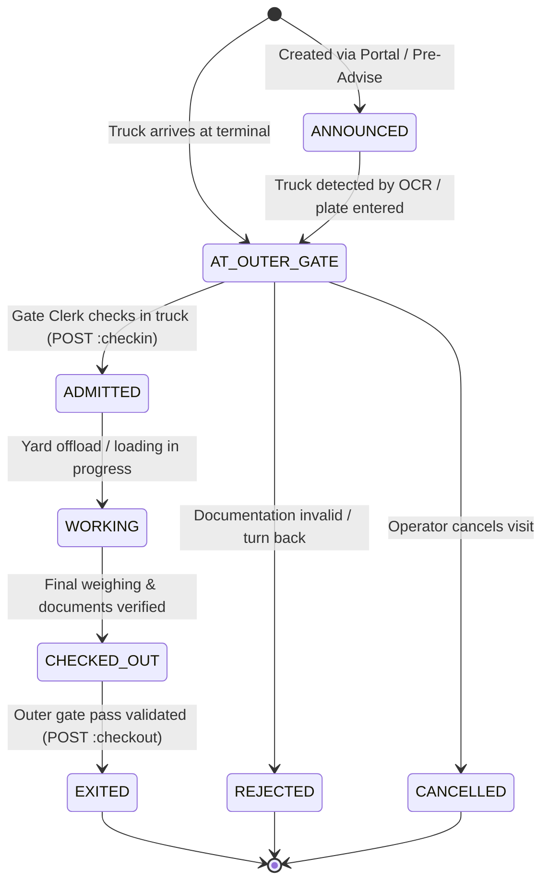

- **Initial Status**: `ANNOUNCED` (or `AT_OUTER_GATE` if walk-in).
- **Available Statuses**: `ANNOUNCED`, `AT_OUTER_GATE`, `ADMITTED`, `WORKING`, `CHECKED_OUT`, `EXITED`, `CANCELLED`, `REJECTED`, `HELD`.
- **API Endpoints**:
  - `POST /api/v1/truck-visits`: Creates visit in `AT_OUTER_GATE` (`current_seq_no = 1`).
  - `POST /api/v1/truck-visits/:id:checkin`: Transitions to `ADMITTED` (`current_seq_no = 2`, `admitted_at = NOW()`).
  - `POST /api/v1/truck-visits/:id:checkout`: Transitions to `EXITED` (`current_seq_no = 4`, `exited_at = NOW()`).
  - `POST /api/v1/truck-visits/:id:cancel`: Transitions to `CANCELLED`.
- **Authorized Roles**: `GATE_CLERK`, `GATE_SUPERVISOR`.

---

### 1.2 Container Physical Status (`unit_stay.physical_status`)

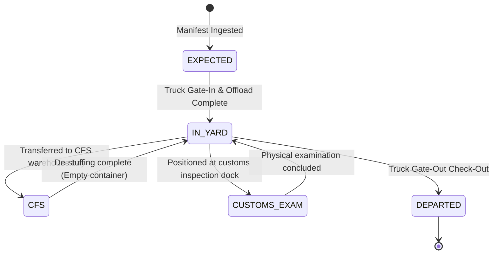

- **Initial Status**: `EXPECTED`.
- **Available Statuses**: `EXPECTED`, `IN_YARD`, `CFS`, `CUSTOMS_EXAM`, `DEPARTED`.
- **Database Updates**: `gated_in_at` stamped on `IN_YARD`, `departed_at` stamped on `DEPARTED`.

---

### 1.3 Container Customs Status (`unit_stay.customs_status`)

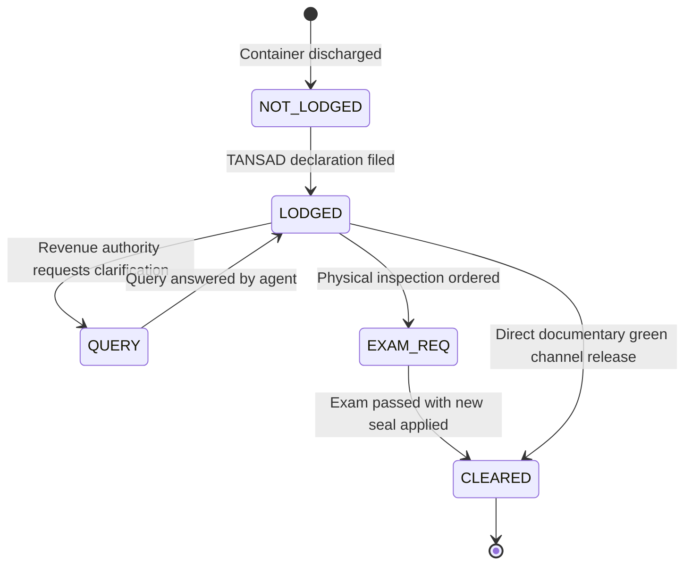

- **Initial Status**: `NOT_LODGED`.
- **Available Statuses**: `NOT_LODGED`, `LODGED`, `QUERY`, `EXAM_REQ`, `CLEARED`.
- **API Endpoint**: `POST /api/v1/exams/:id:complete` (or `POST /api/v1/customs/refs`).
- **Authorized Roles**: `CUSTOMS_OFFICER`.

---

### 1.4 Container Billing Status (`unit_stay.billing_status`)

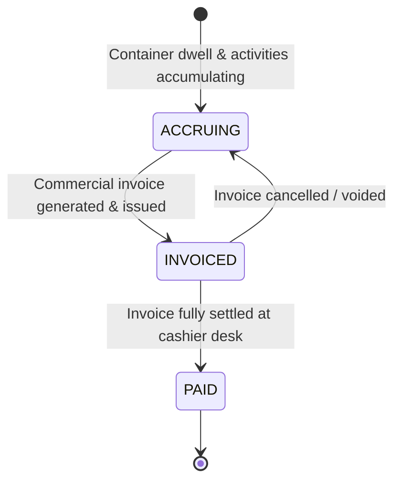

- **Initial Status**: `ACCRUING`.
- **Available Statuses**: `ACCRUING`, `INVOICED`, `PAID`.
- **Transition Condition**: Changes to `PAID` automatically when total payments allocated against all invoices for the `unit_stay` equal or exceed the total billed balance.

---

### 1.5 Cargo Release Status (`unit_stay.release_status`)

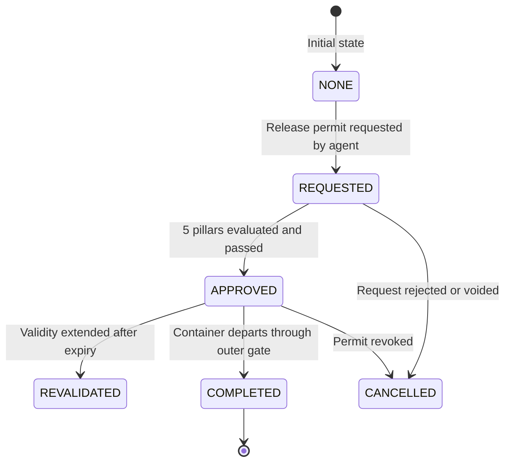

- **Initial Status**: `NONE`.
- **Available Statuses**: `NONE`, `REQUESTED`, `APPROVED`, `REVALIDATED`, `CANCELLED`, `COMPLETED`.
- **API Endpoint**: `POST /api/v1/release-orders/:id:approve`.
- **Side Effect**: Generates dynamic QR token for gate validation.

---

## 2. Yard, Inspection & Work Order Lifecycles

### 2.1 Yard Move Order Status (`move_order.status`)

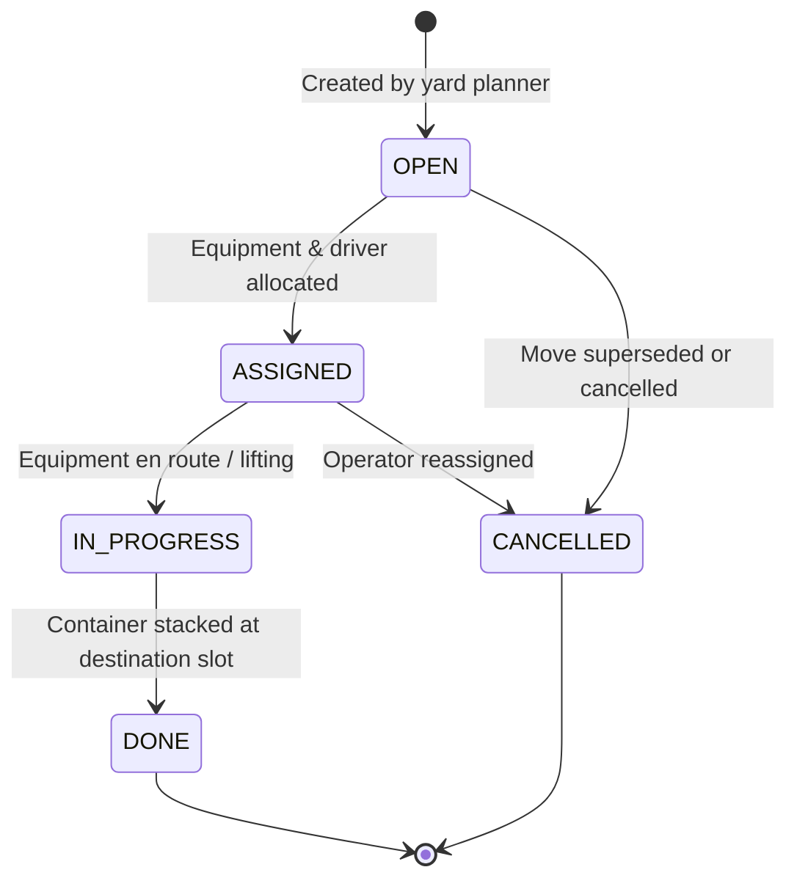

- **Initial Status**: `OPEN`.
- **Available Statuses**: `OPEN`, `ASSIGNED`, `IN_PROGRESS`, `DONE`, `CANCELLED`.
- **Side Effect on `DONE`**: Writes `yard_move` audit record, updates `unit_stay.current_location_id`.

---

### 2.2 Container Inspection Status (`inspection.status`)

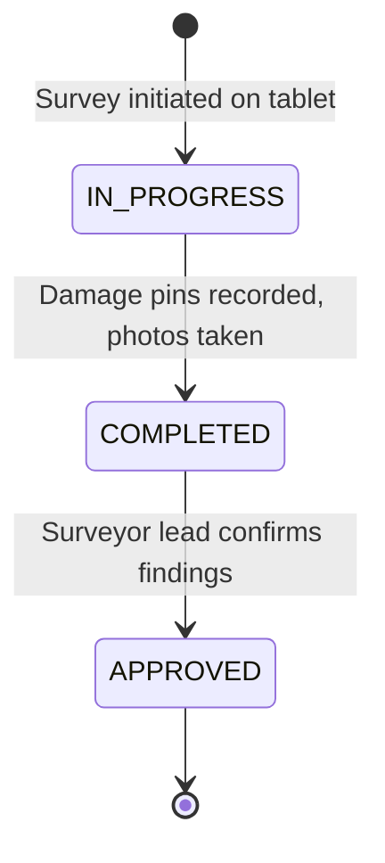

- **Initial Status**: `IN_PROGRESS`.
- **Available Statuses**: `IN_PROGRESS`, `COMPLETED`, `APPROVED`, `CANCELLED`.
- **Side Effect**: If overall condition is `MAJOR_DAMAGE`, creates automatic `hold` and flags container for M&R quotation.

---

## 3. Financial & Governance Lifecycles

### 3.1 Commercial Invoice Status (`invoice.status`)

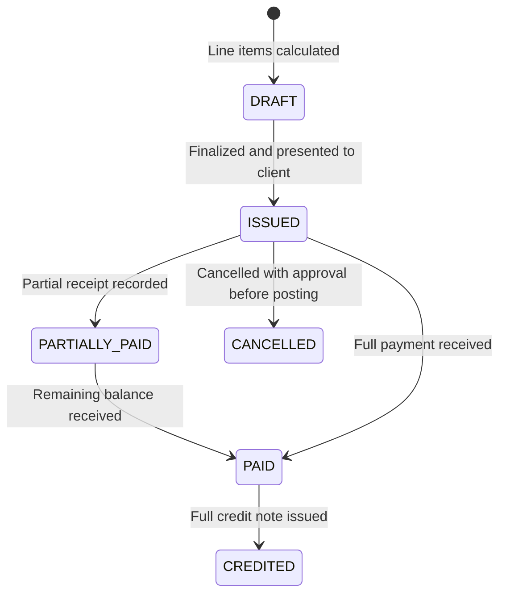

- **Initial Status**: `DRAFT` (or `ISSUED`).
- **Available Statuses**: `DRAFT`, `ISSUED`, `PARTIALLY_PAID`, `PAID`, `CANCELLED`, `CREDITED`.

---

### 3.2 Cashier Shift Status (`cashier_shift.status`)

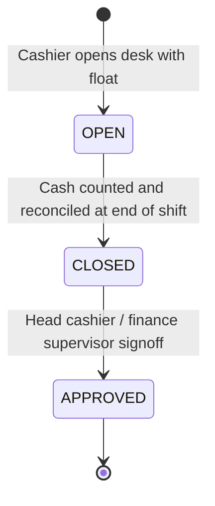

- **Initial Status**: `OPEN`.
- **Available Statuses**: `OPEN`, `CLOSED`, `APPROVED`.
- **Rules**: Cashier cannot record payments unless shift status is `OPEN`.

---

### 3.3 Hold Status (`hold.status`)

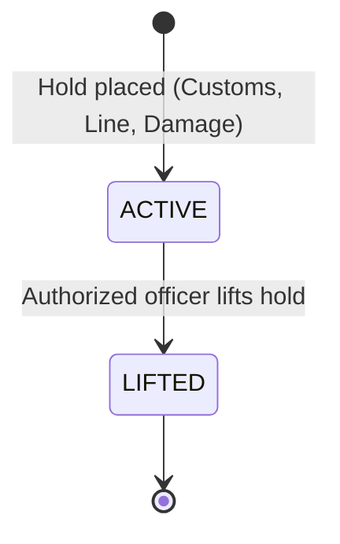

- **Initial Status**: `ACTIVE`.
- **Available Statuses**: `ACTIVE`, `LIFTED`.
- **Side Effect**: Placing increments `unit_stay.active_hold_count`; lifting decrements it.

---

### 3.4 Approval Request Status (`approval_request.status`)

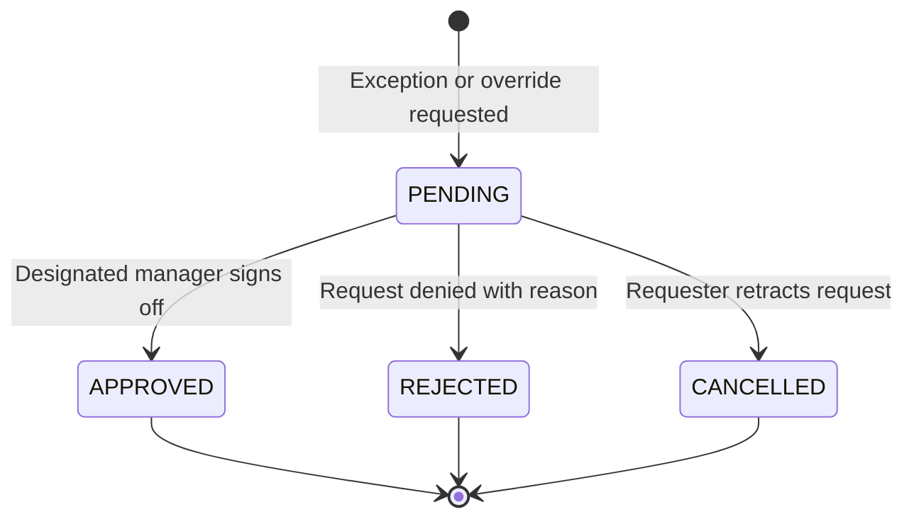

- **Initial Status**: `PENDING`.
- **Available Statuses**: `PENDING`, `APPROVED`, `REJECTED`, `CANCELLED`.
- **API Endpoint**: `POST /api/v1/approvals/:id:decide`.

