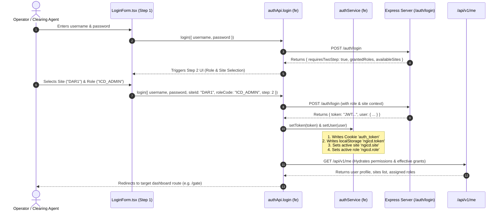

# Document 13: Authentication, Multi-Tenancy & RBAC Permissions

## 1. Authentication Architecture & Session Lifecycle

The **NG ICD** system implements a hybrid authentication strategy combining JSON Web Tokens (JWT), HTTP-accessible cookies (`auth_token`), and browser local storage fallback.



---

## 2. Multi-Tenant Site Context Propagation

The system supports multiple physical facilities within the same database:
- `DAR1` (`site_id: 1`): Dar es Salaam Main ICD Terminal
- `DAR2` (`site_id: 2`): Dar es Salaam CFS & Logistics Hub
- `KBH1` (`site_id: 3`): Kibaha Dry Port & Inland Transit Hub

### Context Ingestion & Propagation:
1. **Frontend Storage**: Active site code is stored in `localStorage.getItem('ngicd.site')` (defaults to `DAR1`).
2. **HTTP Request Interceptor** (`fe/src/services/api/interceptors.ts`):
   Every outgoing request automatically injects the tenant header:
   ```http
   X-Site-Id: DAR1
   X-Role-Code: ICD_ADMIN
   ```
3. **Backend Middleware** (`be/src/middlewares/siteScope.ts`):
   ```typescript
   export function requireSite(isGlobal = false) {
     return (req: Request, res: Response, next: NextFunction): void => {
       if (isGlobal) return next();
       const headerSiteId = (req.headers["x-site-id"] || req.query.siteId || "DAR1")?.trim().toUpperCase();
       const validSite = fallbackStore.sites.find(s => s.siteCode.toUpperCase() === headerSiteId);
       if (!validSite) {
         res.status(404).json({
           type: "https://api.icd.dcc/errors/invalid-site",
           title: "Site Not Found",
           status: 404,
           detail: `Site '${headerSiteId}' is not recognized or is inactive.`
         });
         return;
       }
       req.siteId = validSite.siteId;
       next();
     };
   }
   ```

---

## 3. Role-Based Access Control (RBAC) & Grant Hierarchy

Authorization is enforced at both the route level and the business action level.

### 3.1 Grant Levels & Precedence Matrix
The system implements 4 ascending levels of privilege for every permission code:

| Grant Level | Numeric Precedence | Capability Description |
|---|---|---|
| **`VIEW`** | `1` | Read-only access to view screens, search tables, and inspect records. |
| **`REQ`** | `2` | Requesting actions (e.g., Request Move, Request Waiver, Request Release). |
| **`APPR`** | `3` | Approving requests submitted by operators (Managerial authority). |
| **`DO`** | `4` | Full execution rights (e.g., Check In Truck, Complete Move, Record Payment). |

### 3.2 Backend Grant Verification Middleware (`be/src/middlewares/permission.ts`):
```typescript
const grantPrecedence: Record<Grant, number> = {
  'DO': 4,
  'APPR': 3,
  'REQ': 2,
  'VIEW': 1
};

if (!grant || grantPrecedence[grant] < grantPrecedence[requiredGrant]) {
  res.status(403).json({
    type: 'https://api.icd.dcc/errors/forbidden',
    title: 'Permission Denied',
    status: 403,
    detail: `Role '${role.name}' does not possess '${requiredGrant}' rights for permission '${permission}'. Current grant: ${grant || 'NONE'}.`,
    permission,
    requiredGrant,
    currentGrant: grant || null
  });
  return;
}
```

---

## 4. Role Matrix & Permission Catalog

Configured in `be/src/configs/permissions.ts` and `fe/src/app/roles.ts`:

| Role Code | Role Name | Critical Effective Grants |
|---|---|---|
| **`ALL_PERMISSIONS`** | System Administrator / Superuser | `DO` on all 70+ permissions. |
| **`ICD_ADMIN`** | Terminal General Manager | `DO` on admin, config, gate, yard, commercial, releases; `APPR` on financial waivers. |
| **`GATE_CLERK`** | Gate In / Gate Out Operator | `DO` on `gate.visit.checkin`, `gate.visit.checkout`, `gate.pass.issue`; `VIEW` on consignments. |
| **`YARD_PLANNER`** | Yard Controller | `DO` on `yard.move.plan`, `yard.move.execute`, `yard.map.view`; `VIEW` on units. |
| **`EQUIPMENT_OPERATOR`**| Reach Stacker / Crane Driver | `DO` on `yard.move.execute`; `VIEW` on `yard.map.view`. |
| **`WEIGHBRIDGE_OP`** | Scale Inspector | `DO` on `weighbridge.ticket`; `VIEW` on visits. |
| **`CUSTOMS_OFFICER`** | Revenue Authority Officer | `DO` on `customs.exam.perform`, `hold.place`, `hold.lift`; `VIEW` on manifests. |
| **`SURVEYOR`** | Container & Vehicle Surveyor | `DO` on `inspection.perform`, `repair.estimate`; `VIEW` on units. |
| **`CFS_SUPERVISOR`** | Freight Station Supervisor | `DO` on `cfs.job.manage`, `cfs.tally.record`; `VIEW` on consignments. |
| **`REEFER_TECH`** | Reefer Technician | `DO` on `reefer.manage`, `reefer.reading.log`; `VIEW` on yard map. |
| **`BILLING_SPECIALIST`**| Commercial Billing Clerk | `DO` on `billing.invoice.create`, `billing.rates.view`; `REQ` on fee waivers. |
| **`CASHIER`** | Cash Desk Operator | `DO` on `payment.record`, `cashier.shift.manage`, `payment.receipt.print`. |
| **`CUSTOMER` / `AGENT`**| External Importer / Clearing Agent | `VIEW` on own consignments; `REQ` on appointments, release orders, and proformas. |

