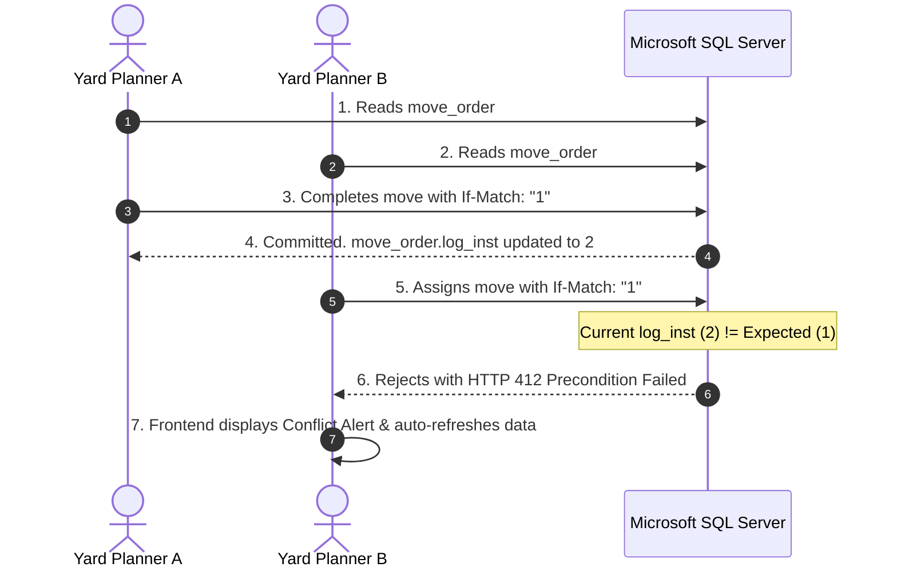
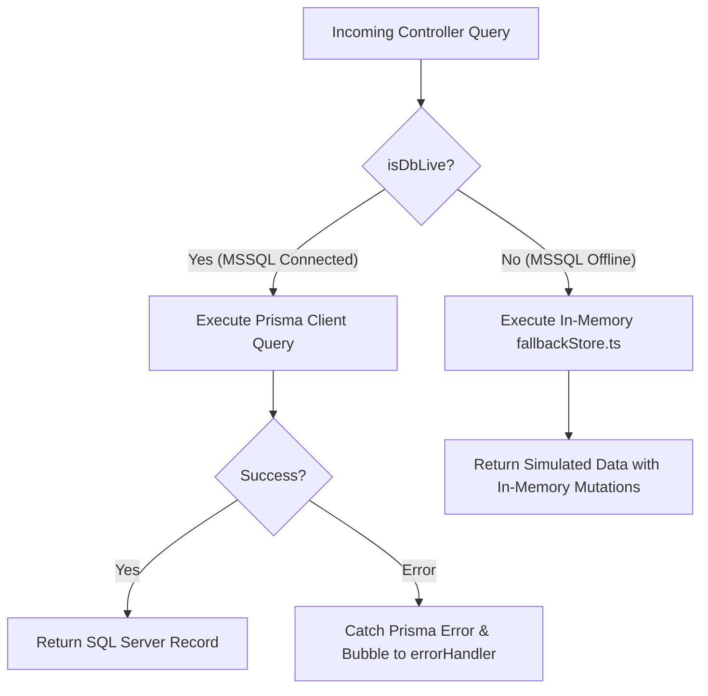

# Document 14: Exception & Error Handling Workflows

## 1. Exception Handling Architecture & RFC 7807 Standard

The backend enforces the **IETF RFC 7807 Problem Details** standard (`application/problem+json`) across all error responses. Runtime errors are intercepted by `be/src/middlewares/errorHandler.ts`:

```json
{
  "type": "https://api.icd.dcc/errors/validation-failed",
  "title": "Validation Failed",
  "status": 422,
  "code": "VALIDATION_FAILED",
  "detail": "One or more request parameters failed validation.",
  "instance": "/api/v1/truck-visits",
  "timestamp": "2026-11-02T14:30:00.000Z",
  "invalidParams": [
    {
      "name": "plateNo",
      "reason": "Required string matching vehicle plate format",
      "path": "body.plateNo"
    }
  ]
}
```

---

## 2. Common Operational Exceptions & Recovery Pathways

### 2.1 Concurrency Precondition Failure (`HTTP 412 Precondition Failed`)



- **Root Cause**: Two operators attempting to modify the same container or work order simultaneously.
- **Handling**: `verifyIfMatch` middleware intercepts the request before writing to database.
- **UI Recovery**: Frontend catches 412, invalidates TanStack cache, and prompts the user: *"This record has been updated by another user. Reloading latest data."*

---

### 2.2 Duplicate Submission / Replay (`HTTP 409 Conflict` / Idempotency Cache)

- **Scenario**: Operator double-clicks **"Record Payment"** or network lag causes client retry.
- **Mechanics**:
  - Mutating calls inject `Idempotency-Key: UUID`.
  - The first call executes and writes the payment to MSSQL.
  - The second call hits `requireIdempotency`, detects the key in cache, returns the cached payment response with header `X-Cache-Lookup: HIT`, and stops duplicate money allocation.

---

### 2.3 Foreign Key Violation (`HTTP 400 Bad Request` / Prisma `P2003`)

- **Scenario**: Creating a `move_order` pointing to a non-existent `yard_location_id` or `unit_stay_id`.
- **Handling**: Global error handler traps Prisma error code `P2003`:
  ```typescript
  if (err.code === 'P2003') {
    statusCode = 400;
    errorCode = 'FOREIGN_KEY_VIOLATION';
    errorTitle = 'Foreign Key Constraint Failed';
    errorDetail = 'The referenced foreign entity does not exist.';
  }
  ```
- **UI Recovery**: Displays form banner identifying which referenced entity is missing.

---

### 2.4 Unrecognized Site Context (`HTTP 404 Site Not Found`)

- **Scenario**: Client sends request with invalid header `X-Site-Id: MOMBASA1`.
- **Handling**: `requireSite` middleware validates against registered facilities (`DAR1`, `DAR2`, `KBH1`).
- **Response**:
  ```json
  {
    "type": "https://api.icd.dcc/errors/invalid-site",
    "title": "Site Not Found",
    "status": 404,
    "detail": "Site 'MOMBASA1' is not recognized or is inactive."
  }
  ```

---

### 2.5 Role Grant Insufficiency (`HTTP 403 Forbidden`)

- **Scenario**: A `GATE_CLERK` attempts to waive an invoice fee (`POST /charges/:id:waive`).
- **Handling**: `requirePermission('billing.charge.waive', 'DO')` checks the caller's role.
- **Result**: `GATE_CLERK` has `VIEW` or `NONE`, which is strictly below `DO` (precedence 1 < 4). Request halts with HTTP 403.
- **UI Recovery**: Modal remains open; error banner displays: *"You do not possess managerial authority to waive charges."*

---

## 3. Database Offline & Fallback Recovery Mechanism

To ensure zero developer downtime and prevent test failure when Microsoft SQL Server is offline:



- If `ENV.DATABASE_URL` is unavailable or connection times out, `initPrisma()` gracefully flags `isMssqlConnected = false`.
- Controllers route seamlessly to `fallbackStore.ts`, keeping UI prototypes, gate check-in forms, and yard maps fully operational.

