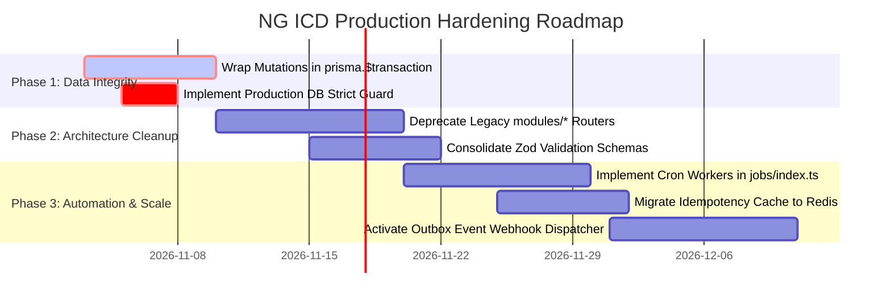

# Document 15: Application Gaps, Technical Debt & Architectural Recommendations

## 1. Executive Findings Summary

Static code analysis of the **NG ICD – DCC Logistics Suite** codebase demonstrates a remarkably thorough and sophisticated design. The domain models, OpenAPI 3.1 specification, and React UI screens align closely with real-world port terminal operations.

However, transitioning from the current prototype/pre-production stage to a mission-critical, live 24/7 port environment requires addressing specific architectural gaps, dual-routing redundancies, transaction safety gaps, and mock fallbacks.

---

## 2. Confirmed Application Gaps & Technical Debt

### 2.1 Lack of Explicit Atomic Transactions (`prisma.$transaction`)
- **Location**:
  - Gate Check-In (`be/src/v1/controllers/gate/visits.controller.ts`)
  - Yard Move Completion (`be/src/v1/controllers/yard/moves.controller.ts`)
  - Cashier Payment & Allocation (`be/src/v1/controllers/billing/cashier.controller.ts`)
- **Confirmed Finding**:
  In `completeMove`, the controller executes multiple sequential queries without wrapping them in `prisma.$transaction`:
  ```typescript
  // 1. Update move_order
  await prisma.move_order.update({ ... });
  // 2. Update unit_stay location
  await prisma.unit_stay.update({ ... });
  // 3. Create yard_move audit
  await prisma.yard_move.create({ ... });
  ```
- **Operational Risk**: If the server crashes or MSSQL deadlocks during step 2 or 3, the `move_order` is marked `DONE`, but the container's `unit_stay.current_location_id` remains in the old slot, creating a desynchronized "ghost container" in the yard.
- **Recommendation**: Wrap all multi-step state mutations in interactive Prisma transactions:
  ```typescript
  await prisma.$transaction(async (tx) => {
    await tx.move_order.update({ ... });
    await tx.unit_stay.update({ ... });
    await tx.yard_move.create({ ... });
  });
  ```

---

### 2.2 Dual-Router Duplication (`be/src/v1/routes` vs `be/src/modules`)
- **Location**: `be/src/v1/routes/index.ts`
- **Confirmed Finding**:
  The application mounts two full router hierarchies simultaneously:
  ```typescript
  // 1. Category routers
  v1Router.use(gateRoutes);
  v1Router.use(yardRoutes);
  v1Router.use(cargoRoutes);
  v1Router.use(billingRoutes);

  // 2. Legacy module routers
  v1Router.use(gateRouter);
  v1Router.use(yardRouter);
  v1Router.use(cargoRouter);
  v1Router.use(commercialRouter);
  ```
  Both `gateRoutes` and `gateRouter` handle `/truck-visits` and `/gate/visits`. While written to be complementary, having two controllers (`gateVisitsController` vs inline handlers in `gate.router.ts`) creates maintenance ambiguity and risk of route shadowing.
- **Recommendation**: Deprecate the `be/src/modules/*` router files and consolidate all endpoint handling into the structured `be/src/v1/controllers/*` and `be/src/v1/routes/*` hierarchy.

---

### 2.3 Reliance on In-Memory Fallback Stores in Production Builds
- **Location**: `be/src/configs/prisma.ts`, `be/src/data/fallbackStore.ts`, `fe/src/features/auth/api/authApi.ts`
- **Confirmed Finding**:
  When MSSQL is not reachable, the system silently switches to `fallbackStore.ts` rather than failing health checks. While excellent for local UI mock development, if credentials fail in a staging or production container, the application will silently store payments and gate passes in ephemeral server RAM, losing data upon container restart.
- **Recommendation**: Enforce strict environment guards:
  ```typescript
  if (ENV.NODE_ENV === 'production' && !isMssqlConnected) {
    throw new Error('[FATAL] Database connection required in production mode.');
  }
  ```

---

### 2.4 Unused Database Models in Schema
- **Location**: `be/prisma/schema.prisma`
- **Confirmed Finding**:
  The schema declares 127 models, but several advanced Phase 2 models currently have minimal or zero active controller logic:
  - `tenant_migration_run`, `schema_migration`
  - `ml_model_version`, `dwell_prediction`, `occupancy_forecast`
  - `outbox_delivery`, `outbox_event` (Outbox table exists, but scheduled polling worker in `be/src/jobs/index.ts` is an empty stub: `export function initJobs(): void {}`).
- **Recommendation**: Implement the background outbox event worker in `be/src/jobs/index.ts` to dispatch webhooks and EDIFACT messages to shipping lines.

---

### 2.5 Incomplete Background Job Scheduler (`be/src/jobs/index.ts`)
- **Location**: `be/src/jobs/index.ts`
- **Confirmed Finding**:
  The file contains:
  ```typescript
  export function initJobs(): void {}
  ```
  Demurrage calculation, reefer temperature overdue alerts, and unclosed shift monitoring currently depend on user-triggered requests rather than an automated cron runner (`node-cron`).
- **Recommendation**: Integrate `node-cron` or BullMQ to execute automated midnight storage accruals and reefer 2-hour monitoring sweeps.

---

## 3. Potential Risks Requiring Manual Verification

| Risk Area | Code Observation | Verification Required |
|---|---|---|
| **SQL Server BigInt JSON Serialization** | Controller uses `Number(v.truck_visit_id)` or `parseBigIntId` | Verify that JavaScript `Number.MAX_SAFE_INTEGER` ($2^{53}-1$) is not exceeded if high-volume production IDs scale up. |
| **Idempotency Cache Memory Leak** | `concurrency.ts` uses an in-memory `Map` | In multi-instance cluster deployments (e.g. Kubernetes), each pod maintains an isolated Map. Needs Redis-backed shared cache. |
| **Cookie Domain & SameSite** | `authService.ts` sets `sameSite: 'Lax'` | Verify behavior under cross-domain port calls when frontend runs on port 5173 and backend on port 4000 without proxying. |
| **Offline Gate Entry Sync** | `truck_visit.is_offline_entry` flag | Verify whether mobile tablet lane app has IndexedDB queue to sync visits when yard Wi-Fi drops. |

---

## 4. Prioritized Engineering Roadmap



